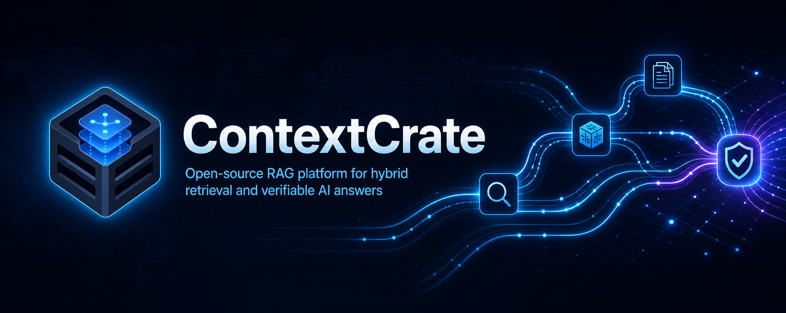
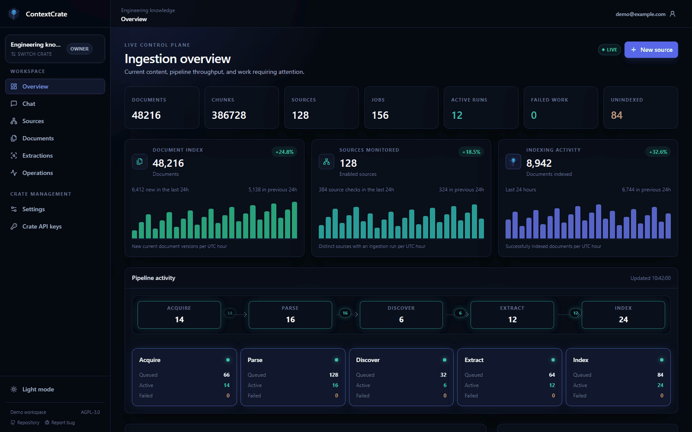
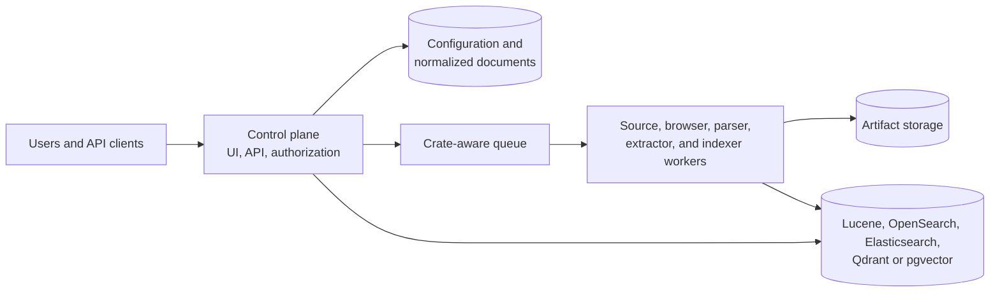
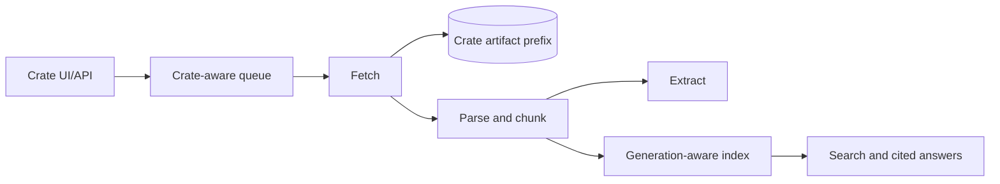

<div align="center">

  <h1>ContextCrate</h1>
  

  <p><strong>Turn your sources into trusted context.</strong></p>
  <p>Open-source, self-hosted RAG for hybrid retrieval and verifiable AI answers.</p>

</div>

ContextCrate is an open-source, self-hosted retrieval-augmented generation platform. It ingests websites and Git repositories, builds searchable context, and delivers grounded answers with citations you can inspect. Its top-level entity is a **crate**: an independently configured and authorized context workspace containing sources, ingestion jobs, documents, extraction rules, provider settings, artifacts, and its own vector-index namespace.

ContextCrate keeps that context on infrastructure you control, combines lexical and semantic retrieval, and makes answer evidence traceable back to the original source. 




## Capabilities

- **Crawl websites reliably** with HTTP or Playwright rendering, robots-policy enforcement, login support, retries, and crawler safety controls.
- **Ingest Git repositories** over public or token-authenticated HTTPS, selecting branches, tags, paths, and Markdown or text content.
- **Organize knowledge into crates** with isolated sources, indexes, settings, members, and service keys for each team or use case.
- **Search with hybrid retrieval** by combining BM25 keyword search and semantic vectors with reciprocal-rank fusion, filters, and optional cross-encoder reranking.
- **Generate grounded answers** through OpenAI-compatible models, with streaming responses, stable source lists, and inline citations that lead back to the indexed evidence.
- **Connect any OpenAI client** to a crate directly — Open WebUI, LiteLLM, the OpenAI SDKs — through a per-crate OpenAI-compatible `chat/completions` endpoint, no custom integration code required.
- **Tune every stage of the RAG pipeline** — chunking, retrieval, answer generation and evaluation — per crate, see the [RAG toolbox](#rag-toolbox) below.
- **Give a crate its own storage or search backend** when the administrator allows it: a dedicated S3-compatible bucket and/or an OpenSearch, Elasticsearch, Qdrant or pgvector service, chosen and connection-tested in the create dialog, with the installation's providers as the default.
- **Choose your AI providers** with local ONNX models or OpenAI-compatible embedding, reranking, and answer endpoints configured per crate.
- **Manage data safely** with document versions, background index rebuilds, archive/restore, checksummed crate export/import, and audit-aware access controls.
- **Automate through the UI or API** using personal API keys and crate-specific Viewer or Editor service keys.
- **Deploy from laptop to cluster** with standalone Docker or Compose for compact installs and Kubernetes with PostgreSQL, RabbitMQ, S3-compatible storage, and OpenSearch, Elasticsearch, Qdrant or pgvector for production scale.

## RAG toolbox

Every option is switchable per crate or ingestion job, off by default, and documented with a diagram and tuning advice. Combine them and measure the effect with the built-in evaluation.

### Chunking and indexing

| Option | What it does |
|---|---|
| [Structure-aware chunking](docs/features/chunking.md) | Splits by headings, paragraphs and code blocks instead of at a fixed position; configurable size and overlap per ingestion job. |
| [Semantic chunking](docs/features/semantic-chunking.md) | Embeds every sentence and cuts where the topic changes, using a percentile, standard-deviation or interquartile-range threshold. |
| [Contextual chunk headers](docs/features/contextual-headers.md) | Puts an LLM-written title, summary and section path in front of each chunk before it is embedded, so fragments keep their context. |
| [Proposition retrieval](docs/features/retrieval.md) | Indexes self-contained, graded statements extracted from each chunk instead of the raw chunk. |
| [Document enrichment](docs/features/document-enrichment.md) | The mirror image of HyDE: a model writes N questions (3 to 50) per chunk at indexing time; they are embedded and point back at the chunk, so user questions match questions, and the parent chunk is returned. |
| [Images](docs/features/images.md) | Indexes images by alt text and optional vision-model descriptions. |

### Retrieval

| Option | What it does |
|---|---|
| [Hybrid search](docs/features/retrieval.md) | BM25 keyword and semantic vector search fused with reciprocal-rank fusion, plus optional cross-encoder [reranking](docs/reranking.md). |
| [Query transformation](docs/features/query-transformation.md) | Rewrites the question, asks a step-back question or splits it into sub-queries, chosen manually or automatically. |
| [HyDE](docs/features/hyde.md) | Embeds an LLM-written hypothetical answer instead of the question to find the real chunks. |

### Answer generation

| Option | What it does |
|---|---|
| [System prompts](docs/features/system-prompts.md) | Built-in rules, an optional installation-wide prompt and an optional crate prompt (if the administrator allows it) adjust tone, language and focus; later layers cannot override earlier ones. |
| [Context window](docs/features/context-window.md) | Adds the neighbouring chunks of each match (configurable 0 to 5) and restores the original text without overlap. |
| [Contextual compression](docs/features/contextual-compression.md) | A model keeps only the sentences of each theyretrieved chunk that are relevant for the question, dropping tangents, transitions and duplicates to save tokens. |
| [Grading](docs/features/grading.md) | Judges retrieved chunks for relevance and drops the noise before the model sees it. |
| [Answer verification](docs/features/answer-verification.md) | Checks the answer against its sources and revises, blocks or warns about unsupported claims. |
| Grounded, cited answers | Streaming answers with stable sources and inline citations, also via an OpenAI-compatible endpoint and MCP. |

### Evaluation and observability

| Option | What it does |
|---|---|
| [RAG evaluation](docs/features/evaluation.md) | An LLM judge scores context relevance (Precision/Recall@K, MRR, MAP, NDCG), faithfulness, answer relevance and completeness, asynchronously and per crate, with an optional golden question set. Visible to crate owners. |
| [Prometheus and Grafana](docs/operations.md) | Metrics for every stage and a ready-made [dashboard](docs/grafana/README.md) with a crate selector. |

## Architecture

The **control plane** exposes the crate-qualified UI and API, applies membership authorization, and owns configuration plus normalized documents in the relational database. **Workers** acquire website and Git sources, optionally render pages in a browser, normalize content, extract metadata, and build the search index. A crate-aware queue coordinates that work; raw source bodies live in artifact storage, while the search index (built-in Lucene, or OpenSearch, Elasticsearch, Qdrant or PostgreSQL with pgvector) serves lexical, semantic, and hybrid retrieval.



**Standalone** runs the control plane, workers, queue, H2 database, filesystem artifacts, and Lucene in one JVM. It is designed for local use and compact single-instance deployments. 

**Distributed** runs the control plane and worker roles separately, with PostgreSQL, RabbitMQ, S3-compatible storage, and OpenSearch, Elasticsearch, Qdrant or pgvector; each workload can then scale independently. 

Kubernetes is the intended production deployment. See the [architecture documentation](docs/architecture.md) and [Kubernetes installation guide](docs/installation/kubernetes.md) for the complete design.

## Pipeline example

An ingestion run begins when a crate submits a website or Git source to the queue. Fetch workers acquire the selected pages or repository files and retain the raw result in crate-scoped artifact storage. Parser workers then normalize that content into documents and deterministic chunks. Extraction creates optional derived metadata, while the indexer builds a new search generation from the normalized records. Once the generation is complete, ContextCrate can serve lexical, semantic, or hybrid search and use the selected evidence to stream cited answers.



Raw artifacts remain separate from normalized documents so parsing and indexing can be rebuilt without re-crawling the original source. Every content row, queue message, artifact key, and search operation carries crate identity. Lucene uses `data/index/crates/{crateId}/{generation}`; OpenSearch, Elasticsearch and Qdrant use `{prefix}-crate-{crateId}-{generation}`; pgvector uses one table per crate and generation. See the [pipeline documentation](docs/pipeline.md) for work lifecycle, connector behavior, retries, and indexing details.


## Quick start

ContextCrate is intended for Kubernetes in production. The Helm-based Kubernetes installation is documented in the [installation guides](docs/installation/kubernetes.md). Docker and Docker Compose are useful for local development, evaluation, and smaller standalone deployments.

### Docker

Run a standalone instance with a persistent named volume:

```bash
docker run --rm -p 8080:8080 -v contextcrate-data:/app/data -e CONTEXTCRATE_ADMIN_PASSWORD=change-me ghcr.io/wenisch-tech/contextcrate:latest
```

### Docker Compose

Run the standalone Compose setup from a source checkout:

```bash
CONTEXTCRATE_ADMIN_PASSWORD=change-me docker compose up --build
```

Open <http://localhost:8080> and sign in with `admin@contextcrate.local` and the password you set. The named volume preserves application data and downloaded local models between restarts.

For the distributed evaluation stack, use `CONTEXTCRATE_ADMIN_PASSWORD=change-me docker compose -f compose.distributed.yml up`. It includes PostgreSQL, RabbitMQ, MinIO, and OpenSearch for experimentation; use Kubernetes with independently operated backing services for production.

The first authenticated user owns the automatically migrated Legacy crate. New users see crate onboarding according to the global creation policy. For a production deployment, configure a persistent data volume and set `CONTEXTCRATE_ADMIN_PASSWORD` before exposing the service.

## Documentation

The full documentation is available at **[contextcrate.eu/docs](https://contextcrate.eu/docs/)**.

**Get started**
- [Installation overview](https://contextcrate.eu/docs/installation/) · [Docker](https://contextcrate.eu/docs/installation/docker/) · [Docker Compose](https://contextcrate.eu/docs/installation/compose/) · [Kubernetes](https://contextcrate.eu/docs/installation/kubernetes/) · [JAR](https://contextcrate.eu/docs/installation/jar/)
- [Using ContextCrate](https://contextcrate.eu/docs/usage/) and [Tutorials](https://contextcrate.eu/docs/tutorials/)

**Concepts and architecture**
- [Architecture](https://contextcrate.eu/docs/architecture/) · [Crates and lifecycle](https://contextcrate.eu/docs/crates/) · [Pipeline](https://contextcrate.eu/docs/pipeline/) · [Authorization](https://contextcrate.eu/docs/authorization/)
- [Search backends: Lucene, OpenSearch, Elasticsearch, Qdrant, pgvector](https://contextcrate.eu/docs/search-backends/) · [Dedicated storage and search per crate](https://contextcrate.eu/docs/features/crate-backends/)

**RAG features**
- Chunking and indexing: [Parsing](https://contextcrate.eu/docs/features/parsing/) · [Chunking](https://contextcrate.eu/docs/features/chunking/) · [Semantic chunking](https://contextcrate.eu/docs/features/semantic-chunking/) · [Contextual headers](https://contextcrate.eu/docs/features/contextual-headers/) · [Document enrichment](https://contextcrate.eu/docs/features/document-enrichment/) · [Images](https://contextcrate.eu/docs/features/images/) · [Embeddings](https://contextcrate.eu/docs/embeddings/)
- Retrieval: [Retrieval](https://contextcrate.eu/docs/features/retrieval/) · [Query transformation](https://contextcrate.eu/docs/features/query-transformation/) · [HyDE](https://contextcrate.eu/docs/features/hyde/) · [Reranking](https://contextcrate.eu/docs/reranking/)
- Answer generation: [Answers](https://contextcrate.eu/docs/answers/) · [Context window](https://contextcrate.eu/docs/features/context-window/) · [Contextual compression](https://contextcrate.eu/docs/features/contextual-compression/) · [Grading](https://contextcrate.eu/docs/features/grading/) · [Answer verification](https://contextcrate.eu/docs/features/answer-verification/)
- Evaluation: [RAG evaluation](https://contextcrate.eu/docs/features/evaluation/)

**Integrations and API**
- [REST API](https://contextcrate.eu/docs/api/) · [OpenAI-compatible API](https://contextcrate.eu/docs/integrations/openai/) · [MCP](https://contextcrate.eu/docs/integrations/mcp/)

**Operate**
- [Configuration](https://contextcrate.eu/docs/configuration/) · [Security](https://contextcrate.eu/docs/security/) · [Operations and metrics](https://contextcrate.eu/docs/operations/) · [Grafana dashboard](https://contextcrate.eu/docs/grafana/) · [Export and import](https://contextcrate.eu/docs/backup-migration/) · [Troubleshooting](https://contextcrate.eu/docs/troubleshooting/) · [Upgrade from Harvex](https://contextcrate.eu/docs/upgrade-from-harvex/)

The same pages live in the [`docs/`](docs/) folder of this repository.

ContextCrate is licensed under AGPL-3.0.
