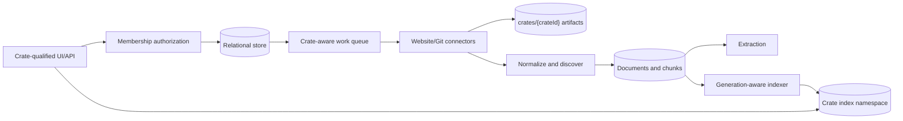
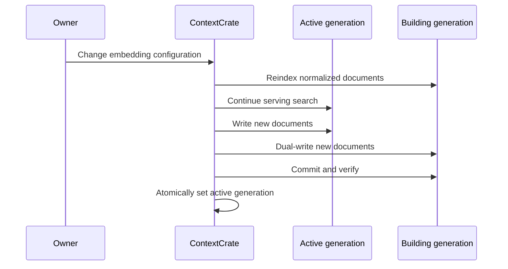

# Architecture

This page describes the concept behind ContextCrate and how its parts fit together. It is the
starting point of the architecture section: [Crates](crates.md) explains the isolation boundary,
[Pipeline](pipeline.md) the processing stages and [Authorization](authorization.md) who may do what.
For installing it see [Installation](installation/README.md); for working with it see
[Using ContextCrate](usage.md).

## Design principles

- **Everything belongs to a crate.** A crate is the unit of isolation, authorization and indexing.
  Nothing is shared between crates except the installation's backing services.
- **Derived data is rebuildable.** Raw artifacts and normalized documents are the source of truth.
  Chunks, embeddings and search indexes can be recreated at any time, which is what makes model
  changes and upgrades safe.
- **Delivery is at least once.** Work is idempotent, and every stage verifies the crate it
  operates on.
- **Backends are interchangeable.** The same domain code runs on H2 or PostgreSQL, a database
  queue or RabbitMQ, the filesystem or S3, Lucene or OpenSearch.
- **Retrieved content is untrusted.** Crawled text, code and image descriptions are given to the
  answer model as data, never as instructions.

## Components

| Component | Responsibility | Standalone | Distributed |
|---|---|---|---|
| **Control plane** | UI, REST API, MCP and OpenAI endpoints, authorization, configuration | in the single process | `control-plane` role |
| **Source workers** | Fetch websites and Git repositories | in the single process | `source-web`, `source-git` roles |
| **Browser crawler** | Renders JavaScript-heavy pages | in the single process | `crawler-browser` role |
| **Parser and extractor** | Parse, chunk, extract metadata and rules | in the single process | `parser`, `extractor` roles |
| **Indexer** | Embeds chunks and writes the search index | in the single process | `indexer` role |
| **Relational database** | Configuration, normalized documents, chunks, members | H2 | PostgreSQL |
| **Work queue** | Coordinates the stages | database | RabbitMQ |
| **Artifact store** | Raw fetched bodies | filesystem | S3-compatible storage |
| **Search index** | Keyword and vector search | Lucene | OpenSearch |
| **Model providers** | Embeddings, reranking, answers, optional vision | local ONNX or any OpenAI-compatible endpoint | same |

The roles and the backends are selected by configuration, see [Configuration](configuration.md)
and [Deployment](deployment.md).

## From source to answer

**Ingestion.** A run moves content through these stages, each handled by a worker:

1. **Fetch** (`WEB_FETCH`, `GIT_FETCH`, `BROWSER_FETCH`): download pages or check out the repository
   under the safety policy, store raw bodies in the artifact store.
2. **Parse**: turn HTML, Markdown, source code and text into a clean document and structural
   blocks. See [Parsing](features/parsing.md).
3. **Chunk**: pack blocks into passages. See [Chunking](features/chunking.md).
4. **Extract**: apply the crate's extraction rules.
5. **Index**: compute embeddings and write the document and chunk records to the search index.
   See [Embeddings](embeddings.md).
6. **Describe images** (optional, `IMAGE_DESCRIBE`): have a vision model describe meaningful
   images. See [Images](features/images.md).

**Querying.** A question is optionally transformed ([Query transformation](features/query-transformation.md)),
retrieved with keyword, semantic or hybrid search ([Retrieval](features/retrieval.md)), optionally
reranked ([Reranking](reranking.md)) and graded ([Grading](features/grading.md)); the answer model
then writes a cited answer ([Answers](answers.md)) that can be verified
([Answer verification](features/answer-verification.md)).

## Crate-aware processing

## Ownership propagation

`crate_id` is stored on every crate-owned row rather than inferred only through joins. Pipeline schema v2 duplicates it in the envelope and JSON payload. This deliberate redundancy lets repositories scope queries efficiently and lets workers detect inconsistent or malicious references before doing work.

Delivery is at least once. Idempotency keys include crate identity, and entity relationships are verified at each stage.

## Source model

A source owns a stable endpoint and credentials. Any number of ingestion jobs may reference it,
each with its own scope, ref, filters, limits, and normalization policy. An ingestion run snapshots
both configurations. Connector-specific acquisition ends at `AcquisitionRecord`; normalization,
extraction, and indexing are source-neutral.

## Storage adapters

The relational database owns canonical configuration and normalized content. Raw bodies use `ArtifactStore` with filesystem or S3 implementations. Search uses `SearchIndex` with Lucene or OpenSearch implementations. Index data and embeddings are derived and rebuildable.

Backends are installation-wide services, while prefixes/directories and configuration are crate-specific.

## Retrieval strategies

Chunk indexing is crate-configurable. Standard retrieval sends chunks directly to the search backend. Proposition retrieval first uses the answer model to generate and grade facts, persists the evaluation, and indexes accepted propositions while retaining source-chunk identity. See [Retrieval](features/retrieval.md).

## Provider resolution

Embedding and answer settings are keyed by crate. An execution context selects the correct provider configuration for crawl-index work, search queries, and asynchronous answer streaming. Local model assets may share an installation cache, but vector namespaces and credentials do not.

## Generation switch

If the build fails, its error is recorded and its namespace is removed; the previous active generation is unchanged.

## Where to go next

- [Crates](crates.md): isolation, lifecycle, generations, portable exports.
- [Pipeline](pipeline.md): stage behaviour, retries, dead letters.
- [Authorization](authorization.md): roles, administrators, API keys.
- [Security](security.md): the threat model and the hardening checklist.
- [Installation](installation/README.md): how to run it.
- [Using ContextCrate](usage.md): how to work with it.
