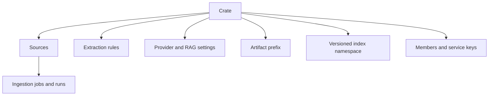
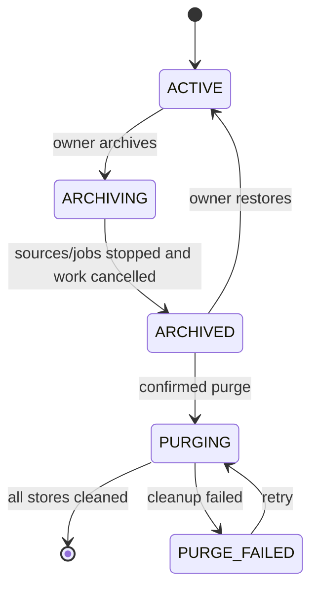

# Crates

A **crate** is ContextCrate's mandatory isolation and collaboration boundary. It contains sources,
ingestion jobs and runs, artifacts, normalized documents, chunks, extraction rules and results,
retrieval settings, provider credentials, and vector-index generations.

The term *namespace* is reserved for the physical Lucene directory, OpenSearch or Elasticsearch index, Qdrant collection or pgvector table owned by a crate. It is never used as a synonym for a crate in the UI or API.

## Isolation guarantees

Every persisted content record carries `crate_id`. Queue envelopes and payloads carry the same identifier, artifact keys begin with `crates/{crateId}/`, and search routes to the active index generation belonging to that crate. A run ID can narrow a search, but it cannot replace crate scope.

Repository and service methods must receive the crate explicitly. Controllers authorize the requested crate before loading a resource, and workers reject messages whose envelope, payload, and referenced entities disagree.

## Creation

The global administrator selects one creation policy:

| Mode | Behavior |
|---|---|
| `EVERYONE` | Every active user may create crates and becomes Owner. This is the default. |
| `ADMINS_ONLY` | Only installation administrators may create crates. |
| `ENTITLED_USERS` | Administrators grant creation permission per account. |

Users without a membership see crate onboarding when creation is allowed. Otherwise, ContextCrate explains that an administrator must assign a crate.

## Lifecycle

## Duplicating a crate

Global administrators can copy a crate under **Administration → Crates → Duplicate** (`POST /api/v1/crates/{crateId}/duplicate`), for example to compare settings in a second crate. The dialog asks for a new name and for the storage and search backend, like the create dialog (including the administrator policy for dedicated backends).

Copied: sources, ingestion jobs (enabled state, schedule, Git tokens, crawler logins), extraction rules and the retrieval, answering, provider and evaluation settings including system prompt and API keys. The copy happens on the server; no secret is sent to the browser.
Not copied: documents, runs, the search index, members and API keys. The new crate is owned by the administrator who made it and starts empty. Jobs stay enabled and scheduled as in the original, so the copy starts ingesting by itself; switch jobs off first if that is not wanted.

An administrator could use this to place the credentials of any crate in a crate they own, so both crates get an audit entry (`CRATE_DUPLICATED`, `CRATE_CREATED_AS_COPY`).

A crate can also be deleted directly, without archiving first: **Settings → Delete crate** for owners and **Administration → Crates → Delete** for global administrators, with the crate name typed as confirmation (`POST /api/v1/crates/{crateId}/delete`). It enters `PURGING` from any state.

Archived crates remain readable, searchable, and exportable. Processing and configuration mutations are blocked. Purge requires the exact crate name and removes keys, elevations, queued work, artifacts, index generations, and relational content through an idempotent background operation.

## Index generations

Lucene namespaces use `data/index/crates/{crateId}/{generation}`. OpenSearch and Elasticsearch indices and Qdrant collections use `{prefix}-crate-{crateId}-{generation}`; pgvector tables use `{prefix}_c{crateId without dashes}_{generation}`.

Changing the embedding configuration creates a background generation. The old generation remains active while documents are rebuilt. New document indexing is dual-written to every building generation. ContextCrate commits and activates the new generation only after the rebuild succeeds; failure leaves the previous generation searchable.

## Portable crates

Owners can export a crate with or without raw artifacts. Bundles contain a schema-versioned
manifest and SHA-256 checksums. Provider keys, source credentials, users, memberships, API keys,
elevations, and audit logs are excluded.

Import always creates a new crate and remaps internal UUIDs. Missing source credentials must be
entered by the new owner, and imported documents are queued for indexing into a new namespace.

## See also

- [Architecture](architecture.md): how crates fit into the system.
- [Authorization](authorization.md): roles, administrators and API keys.
- [Using ContextCrate](usage.md) and [Tutorials](tutorials.md): creating and working with crates.
- [Export, import and recovery](backup-migration.md): moving crates between installations.
- [Administration](operations/administration.md): the crate-creation policy.

## Dedicated storage and search

A crate normally uses the installation's artifact storage and search backend. If the administrator allows it, a crate can be created with its own S3-compatible storage and/or its own search backend; the choice is fixed afterwards. See [Dedicated storage and search per crate](features/crate-backends.md).
