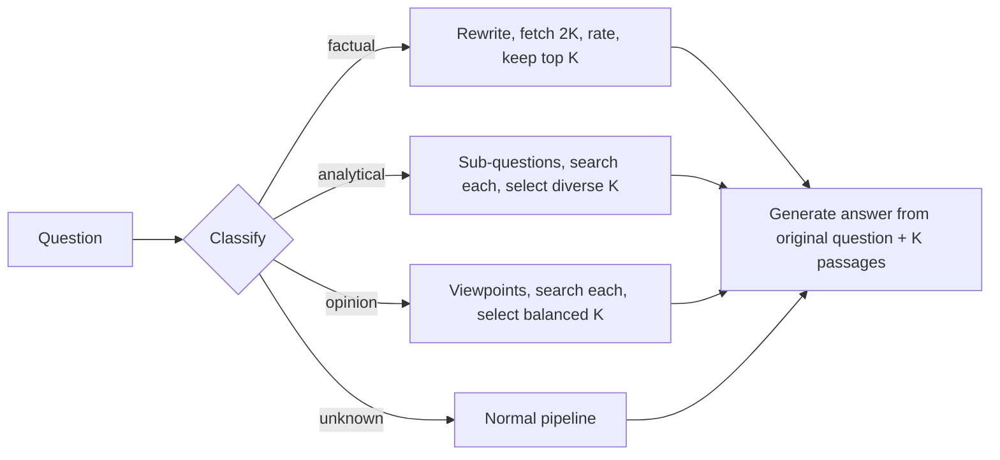

# Adaptive retrieval

Adaptive retrieval is an optional per-crate feature that chooses the retrieval strategy per question. One extra call to the answer model classifies the question into one of three categories, and each category is retrieved differently. Generation is identical for all categories: the final set of passages and the **original question** go to the answer model, and grading and verification keep using the original question too.

Off by default. Switch it on under Crate settings → Adaptive retrieval or with `adaptiveRetrievalEnabled` in `PUT /api/v1/crates/{crateId}/settings/rag`. It needs no index rebuild.

## Categories

| Category | Typical question | Retrieval |
| --- | --- | --- |
| `factual` | "Which port does the service use?" One right passage is needed. | The question is rewritten into a precise query (the [query transformation](query-transformation.md) rewrite strategy). **Twice** the candidates (2K instead of K) are retrieved. The model rates their relevance and the top K are kept. |
| `analytical` | "Compare the backup options and their trade-offs." A broad answer is needed, a single search rarely covers it. | The model splits the question into 2-4 focused sub-questions that each cover a different angle. Every sub-question (and the original) is searched. The model looks at the whole pool and selects K passages that are relevant **and** diverse, so every document contributes something new and nothing is repeated. |
| `opinion` | "Is it worth switching to X?" Balance is needed. | The model identifies the viewpoints that the sources may take. Each viewpoint is combined with the original question into a search query and searched separately. The model looks at the pooled passages and selects K that represent the broadest spectrum of opinion. |

If the classification fails or is unclear, the normal pipeline runs (including query transformation if it is enabled).

## Interaction with other features

- **Query transformation:** while adaptive retrieval classifies a question, it plans the queries; the configured query transformation strategies are not applied to that question. The factual path reuses the rewrite strategy.
- **Dartboard:** replaced by the model's diversity selection for that question.
- **HyDE, hierarchical retrieval, feedback weighting, reranking, retrieval mode:** apply as configured to every search.
- **Grading, context window, compression, verification:** unchanged, they run after retrieval.

## Cost

One classification call plus, depending on the category, one planning call (rewrite, decomposition or viewpoints) and one selection call over the candidate pool (about 500 characters per candidate). The question and candidate passages are sent to the answer provider. Every step is fail-open: a failed selection keeps the retrieval ranking and a failed planning step searches the original question.

## Observability

- `answer_adaptive_total{category,outcome}`: classifications.
- `answer_adaptive_step_total{step,outcome}`: `decompose`, `perspectives` and `select` steps.
- `answer_adaptive_duration_seconds{step}`: time per step (`classify`, `decompose`, `perspectives`, `select`).
- `answer_adaptive_queries{step}` and `answer_adaptive_pool{category}`: queries generated and candidates shown to the model.
- `llm_requests_total{purpose="adaptive"}` and `llm_duration_seconds{purpose="adaptive"}`.

The applied strategy is recorded as `adaptive:<category>` in the `transform=` field of the answer audit entry.
