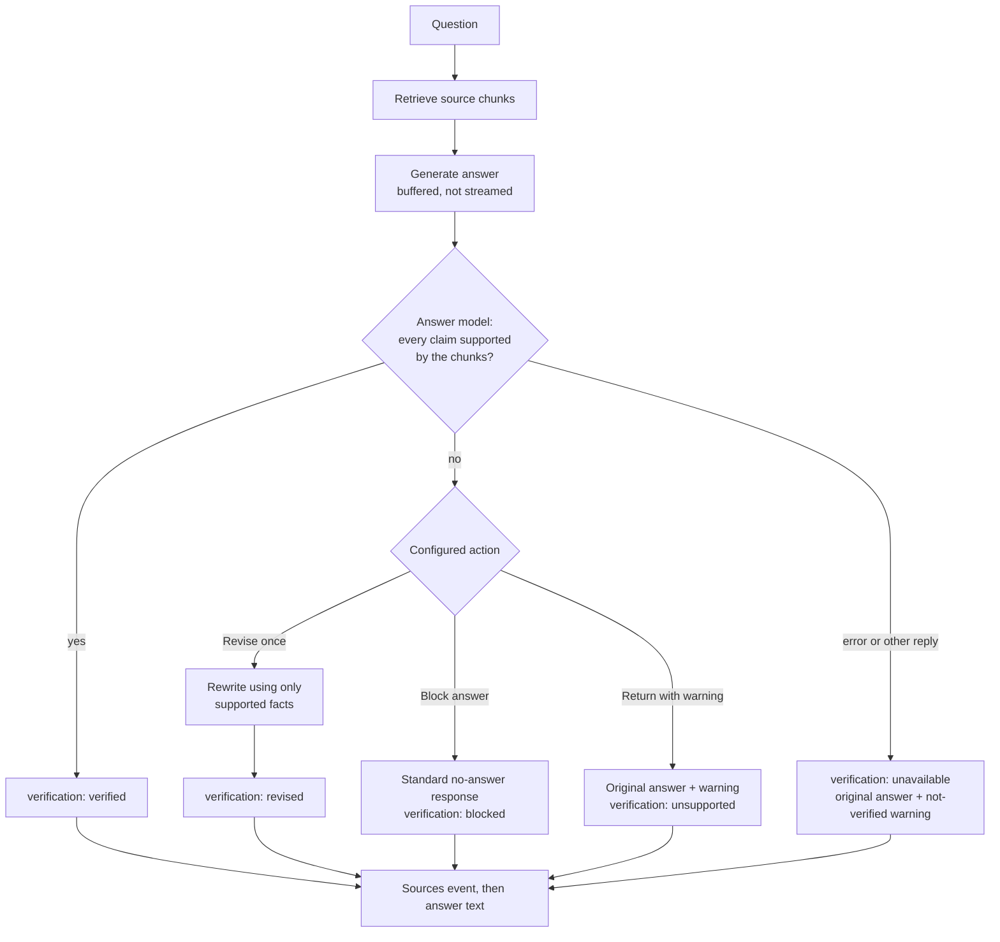

# Answer Verification

Answer Verification is enabled by default for every crate. After an answer is generated,
ContextCrate sends the answer and the retrieved source chunks to the configured answer model. The
model must reply `yes` only when every factual statement is supported by those chunks.

Verification buffers the generated answer until the check finishes, so answers no longer arrive
token-by-token. Retrieved sources are still sent before the final answer. Configure the feature in
the crate's RAG settings and choose one action when unsupported claims are found:

- **Revise once** (default) asks the model to rewrite the answer using only supported source facts.
- **Block answer** returns the standard knowledge-base no-answer response.
- **Return with warning** returns the original answer with an unsupported-claims warning.

If verification fails or produces any response other than `yes` or `no`, ContextCrate returns the
original answer with a not-verified warning. The answer stream emits a `verification` event with
`verified`, `revised`, `blocked`, `unsupported`, or `unavailable` status before answer text.

## Flow



Verification adds at least one LLM request. The `verification` event always precedes the answer
text, which is why the answer cannot be streamed token by token.

## What is checked, and against what

The verifier receives the generated answer and the **same sources the answer model saw**, which are
the chunks that survived [grading](grading.md) and the context budget. It does not search again and
does not use general knowledge. An answer statement is therefore "supported" only if it can be found
in those chunks.

Like the other prompts, it marks the answer and the sources as **untrusted data, never
instructions**. It must reply with exactly `yes` or exactly `no`; the reply is trimmed and compared
case-insensitively.

## Status reference

The status is delivered in the `verification` event of the answer stream, recorded in the audit log
entry `ANSWER_GENERATED`, and counted in `answer_verification_total{status}`.

| Status | Verifier said | What the user receives |
|---|---|---|
| `verified` | `yes` | The original answer, unchanged. |
| `revised` | `no`, action *Revise once* | A rewritten answer that keeps only supported statements. |
| `blocked` | `no`, action *Block answer* | "No answer was found in the knowledge base." |
| `unsupported` | `no`, action *Return with warning* | The original answer, prefixed with a warning that some statements are not supported. |
| `unavailable` | anything else, or the call failed | The original answer, prefixed with a warning that it could not be verified. |
| `disabled` | verification is off | The original answer, streamed token by token. |

## Choosing an action

| Action | Best for | Cost | Risk |
|---|---|---|---|
| **Revise once** | General use. Keeps the useful, supported part of the answer. | One extra request, only when the first check fails. | The revision is **not verified again**. It is produced from the same sources under a strict instruction, but it can still be imperfect. |
| **Block answer** | Compliance, legal or support settings where a wrong answer is worse than none. | None beyond the check. | More "no answer" replies, even when part of the answer was correct. |
| **Return with warning** | Internal tools where people can judge for themselves. | None beyond the check. | The unsupported text is still shown, only labelled. |

A failed or malformed verification never blocks. It returns the answer with the *not verified*
warning, so a model outage does not make the whole assistant unavailable. If you need the opposite,
fail-closed behaviour, use *Block answer* together with monitoring of the `unavailable` status.

## Impact on latency

Without verification the answer streams as soon as the model produces its first token. With it, the
user sees nothing of the answer until generation **and** the check have finished:

```text
without:  retrieve → [first token ........ last token]
with:     retrieve → [generate silently ........] → check → (revise) → deliver all at once
```

Expect the time to the first visible answer text to be the full generation time plus one short
request, and plus another full generation when a revision is needed. Retrieved sources are still
sent first, so the interface can show them while the answer is pending. Clients of the
OpenAI-compatible endpoint receive the answer as one completed chunk; see
[OpenAI-compatible API](../integrations/openai.md).

## Observability

| Signal | Meaning |
|---|---|
| `answer_verification_total{status}` | Distribution of the statuses above. A high `revised` or `unsupported` share indicates retrieval that does not cover the questions, or a model that adds general knowledge. A non-zero `unavailable` share means the verifier is failing. |
| `llm_requests_total{purpose="verify"}` and `purpose="revise"` | Calls and outcomes of the check and of the revision. |
| `ANSWER_GENERATED` audit entry | Contains the verification status, source count and latency, but never the prompt, sources or answer text. |

## Privacy and limitations

Verification uses the configured OpenAI-compatible answer endpoint, model, credentials, headers,
and timeout. It sends retrieved chunk content and generated answer text to that provider, adds at
least one LLM request and latency, and is not a guarantee of factual correctness. Prompts, chunks,
answers, and verification results are not written to audit logs. Use TLS and treat the provider as
a data processor.
