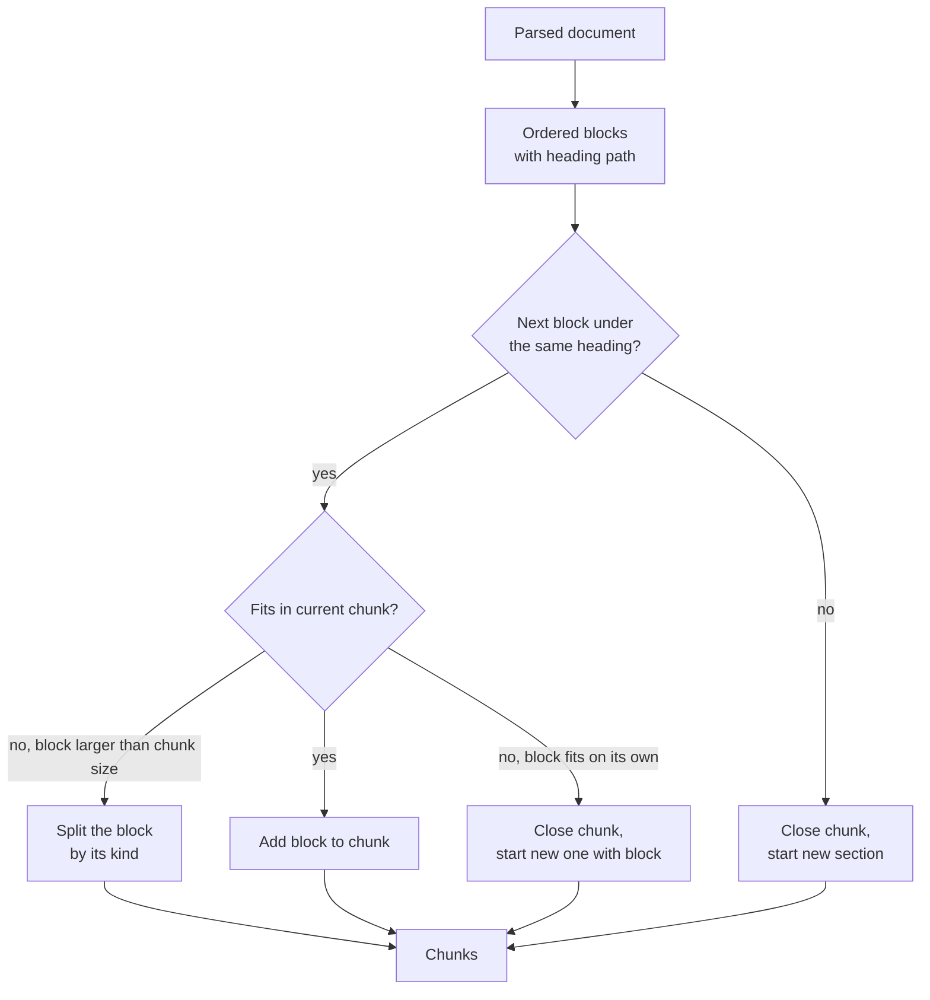
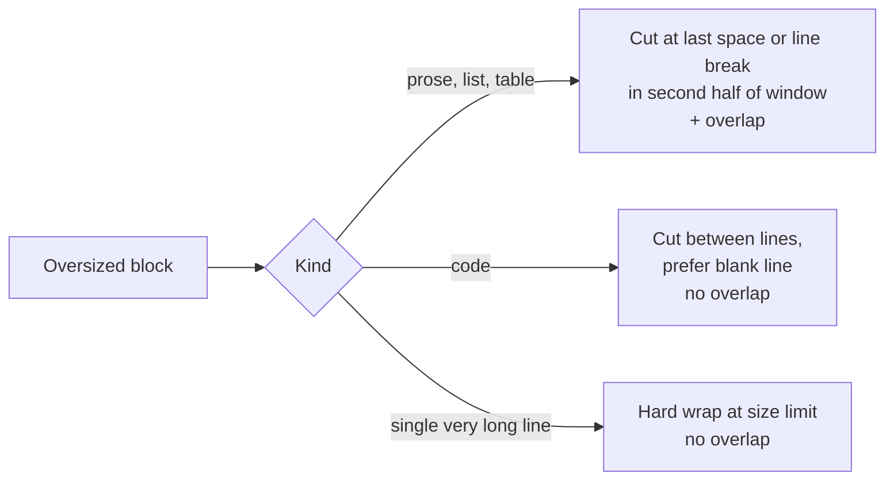

# Chunking

After a document has been parsed (see [Parsing](parsing.md)), ContextCrate cuts it into ordered
**chunks**. Chunks are the unit of everything that follows: each chunk is embedded, indexed for
keyword search, retrieved, reranked, graded, and finally handed to the answer model as context.
The quality of the chunks therefore decides the quality of the answers.

ContextCrate does not cut text at a fixed position. It first splits a document into **blocks**
(a paragraph, a list, a table, a code block) and then packs whole blocks into chunks. A block is
only ever cut when it alone is larger than the chunk size.

## Defaults and settings

New ingestion jobs use a **chunk size of 1,000 characters** and a **chunk overlap of 200
characters**. Both are set per ingestion job in the **Content and chunks** section.

| Setting | Default | Limits | Meaning |
|---|---|---|---|
| Chunk size | 1,000 | at least 200 | Upper bound for a chunk, in **characters** (not tokens). |
| Chunk overlap | 200 | 0 to half the chunk size | Characters repeated at the start of the next chunk when **prose** has to be cut inside a paragraph. |

The embedding provider can lower the size further: with an OpenAI-compatible endpoint the
**Maximum input characters** setting of the provider is an additional upper bound. See
[Embeddings](../embeddings.md#input-limits-and-chunking).

Changing chunk settings only affects documents processed afterwards. Run the ingestion job again
to re-chunk existing content.

## How chunks are built

1. **Blocks.** The parser turns the document into an ordered list of blocks. Each block knows the
   headings above it (its *heading path*) and whether it is prose, code or an image reference.
2. **Sections.** A chunk never crosses a heading boundary. Content below *Guide > Setup* and
   content below *Guide > Usage* always end up in different chunks.
3. **Packing.** Within a section, neighbouring blocks are added to the current chunk until the
   next block would not fit. Then a new chunk starts. A short explanation and the code snippet
   right after it therefore usually share a chunk, which is what a question about "how do I do X"
   needs.
4. **Oversized blocks.** A block larger than the chunk size is split on its own, using the
   strategy that suits its kind (below).



### Splitting an oversized block

| Block kind | How it is split | Overlap |
|---|---|---|
| Prose, lists, tables | At the last space or line break in the second half of the window | Yes, repeated from the previous chunk |
| Code | Only **between lines**, preferring a blank line close to the limit | No |
| A single very long line (for example minified code) | Hard-wrapped at the size limit as a last resort | No |

Code gets no overlap on purpose: repeating half a function in the next chunk adds noise and
produces near-duplicate search hits. Instead, every code chunk carries its language and, where
known, its symbol (see below).

### Example

With a chunk size of 1,000 characters, this Markdown section

````markdown
## Setup

Install the package and start the server:

```bash
npm install
npm start
```

Then open the dashboard.
````

becomes **one** chunk with the heading `Guide > Setup`. The sentence, the code block and the
last sentence stay together, and the fence and its language are preserved. A 4,000 character code
block in the same section would instead become four chunks, each one a run of complete lines.



### Worked example

A Markdown page with these blocks and a chunk size of 1,000 characters:

| # | Block | Heading path | Size |
|---|---|---|---|
| 1 | Intro paragraph | Guide | 350 |
| 2 | Install paragraph | Guide > Setup | 400 |
| 3 | Code block | Guide > Setup | 500 |
| 4 | Closing paragraph | Guide > Setup | 150 |
| 5 | Paragraph | Guide > Usage | 600 |

This produces four chunks:

1. **Block 1.** It is the only content under *Guide*; a chunk never crosses into the next heading.
2. **Blocks 2 and 3 (900).** Adding block 4 would make 1,050, which does not fit, so this chunk is closed.
3. **Block 4.** It starts a new chunk. Block 5 is under a different heading, so it cannot join.
4. **Block 5.**

A single 1,200 character paragraph in the *Setup* section would additionally be split in two, with
the second half starting about 200 characters (the overlap) before the end of the first.

## Chunk metadata

Every chunk stores more than its text:

| Field | Description |
|---|---|
| Heading | The heading path, for example `Guide > Setup > Linux`. For code chunks, the symbol or the file name. |
| Kind | `text`, `code`, or `image` (a description produced by a vision model, or an image file). |
| Language | The programming language for code chunks (`java`, `python`, `yaml`, …) or the fence language. |
| Symbol | For source code, the qualified declaration, for example `UserService.findById`. |
| Start / end line | The line range in the source file, for code chunks. |
| Media URL | For `image` chunks, the address of the image. |
| Ordinal | Position of the chunk in the document. |

### Where the metadata is used

- **Search.** The heading, language and symbol are indexed together with the text. For code
  chunks the retrieval text is prefixed with the language and symbol, for example
  `[java] UserService.findById`, so a search for the function name finds the right chunk even if the
  body never mentions it.
- **Identifier search.** The keyword index splits identifiers into their parts and keeps the
  original: `getUserName` is found by `getUserName`, `user` and `name`; `snake_case_name` by
  `snake_case_name`, `snake` and `case`.
- **Answers and MCP.** Code chunks are given to the model, and returned by the MCP tools, inside a
  fenced block with their language, so formatting and indentation survive.
- **Backups.** The metadata is part of crate export and import. Older exports without it still import.

## Images

When image indexing is on (**Settings → Images**), an image that passes the filter becomes a short
line such as `[Image: Request flow — Figure 2] (https://…/flow.png)`. This line is a block like any
other, so it is packed into the chunk of the paragraph it belongs to and is searchable together
with that text.

With image descriptions on, a vision model's description is added later as a separate chunk of
kind `image` under the heading where the image appeared, and the document is re-indexed. Its
Media URL points to the image, and answers and MCP results show it as `(Image: <url>)`. See
[Images](images.md).

## Code files

Source code is not chunked as text. It is parsed into a syntax tree and cut along its structure:
one chunk per function, class or method, with the comment above a declaration kept together with
it. The details, supported languages and the fallback are described in [Parsing](parsing.md).

## Embedding limits and re-chunking

When an embedding endpoint rejects an input as too large, ContextCrate splits the affected chunks
again and retries, up to eight times. Code chunks are re-split between lines and keep their kind,
language and symbol. This is normally only needed when the provider limit is unknown; for a known
limit set **Maximum input characters** on the provider.

## Tuning

- Smaller chunks (400 to 700 characters) give more precise hits but less context per hit. Use them
  for FAQ-like content.
- Larger chunks (1,500 to 2,500 characters) keep whole procedures or functions together. Use them
  for reference documentation and code. Mind the embedding model's input limit.
- Raise the overlap only for long continuous prose. It has no effect on code or on content that fits
  into blocks smaller than the chunk size.
- After changing the settings or upgrading ContextCrate, re-run the ingestion job so existing
  documents are re-chunked.

## Troubleshooting

| Symptom | Cause | What to do |
|---|---|---|
| Answers cite the right page, but the passage is incomplete | Chunks too small for the content | Raise the chunk size, re-run the ingestion job |
| Search finds the right page but a vague part of it | Chunks too large, so one embedding covers several topics | Lower the chunk size, re-run the job |
| Many tiny chunks | The source has many short sections, each under its own heading | Expected, because chunks never cross headings. Flatten the headings in the source if this hurts quality |
| Embedding errors "input too large" | Chunk size exceeds the embedding model's limit | Set **Maximum input characters** on the provider, see [Embeddings](../embeddings.md#input-limits-and-chunking) |
| Changed chunk size, nothing changed | Settings only apply to documents processed afterwards | Re-run the ingestion job |
| Code appears split in odd places | A function longer than the chunk size is cut between lines | Raise the chunk size for code-heavy sources |
