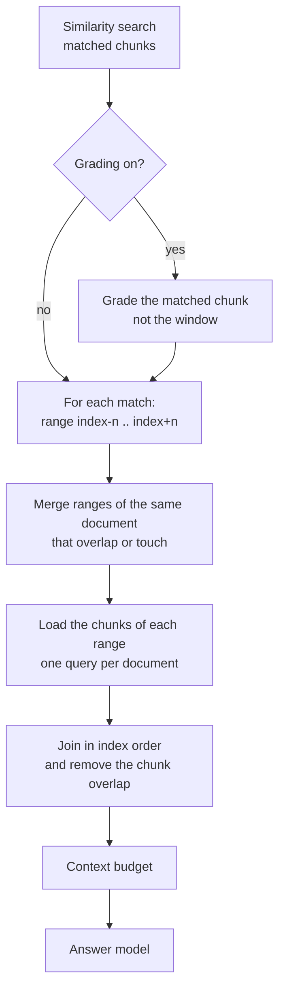

# Context window

A chunk that matches a question is often only a fragment: the sentence that explains it sits in the
chunk before, the continuation in the chunk after. The **context window** fixes this at question
time. Every matched chunk is expanded with the chunks next to it in its document, and the result is
handed to the answer model as one continuous passage.

With a window of **1**, a match at chunk index 7 is sent together with the chunks at index 6 and 8: a
window of three. With a window of 2 it is five chunks, and so on.

The setting is **per crate**, on the crate's **Settings** page, section **Context window**, or
`contextWindow` in the [REST API](../api.md). It is `0` (off) by default, can be 0 to 5, and takes effect
immediately because nothing is re-indexed.

## The chunk index

Every chunk has a **consecutive number within its document**, starting at 0: the *index*. The first
chunk of a document is `#0`, the next `#1`, and so on. The document details page shows it on every chunk
(**Chunk #3**), and the API uses the same number:

```http
GET /api/v1/crates/{crateId}/documents/{documentId}/chunks/{index}
GET /api/v1/crates/{crateId}/documents/{documentId}/chunks/{index}?before=1&after=1
```

The first call returns the chunk, the second the chunk with one neighbour on each side (up to 5), joined
exactly as the answer model would receive them:

```json
{"documentId": "…", "index": 3, "from": 2, "to": 4, "chunkCount": 3, "text": "…"}
```

An index that does not exist in the document returns `404`. Viewers of the crate may call it. The index
changes when a document is re-chunked (for example after a new import of changed content), so do not keep
it as a permanent address; use it together with the document id of the version you read.

## How a window is built



1. The search returns the matched chunks in relevance order, as before. [Grading](grading.md) still judges
   **the matched chunk**, not the larger window, so the relevance decision is not diluted by its
   neighbours.
2. For every kept match the range `index − n … index + n` is computed (cut off at the first and last chunk
   of the document).
3. Ranges of matches in the **same document** that overlap or touch become **one window**. A chunk is never
   sent twice, and two nearby matches read as one passage instead of two overlapping ones.
4. The chunks of each window are loaded and joined **in index order**.
5. Windows keep the relevance order of their best matched chunk. They become the sources of the answer
   and are numbered as usual, so citations such as `[1]` point to a window.

The matched chunk stays the reference of the source: its id, score and snippet are what the source list
shows; only the text that the model reads is larger.

Chunks of kind *image* (descriptions of pictures) are not part of the running text and are skipped
as neighbours. A matched image description is kept.

## Removing the overlap

Prose that is cut in the middle of a long paragraph is chunked with an **overlap**
(see [Chunking](chunking.md#defaults-and-settings)): the next chunk starts with the last characters of the
previous one, so that no sentence falls into the gap between two chunks. Sent to a model as they are,
neighbouring chunks would repeat those characters.

When a chunk is created, ContextCrate stores **how many of its first characters repeat the previous chunk**.
The window drops exactly those characters, which restores the **original text** of the page:

```text
chunk #1  …escalation policy states that the primary engineer must acknowledge every page within five minutes
chunk #2                                                       within five minutes otherwise the secondary is paged…
window    …escalation policy states that the primary engineer must acknowledge every page within five minutes otherwise the secondary is paged…
```

How chunks are joined:

| Chunks | Joined with |
|---|---|
| Cut from one paragraph **with overlap** | The repeated characters are dropped; the result is the original text, byte for byte |
| Cut from one paragraph **without overlap** (overlap set to 0) | A single space |
| Different blocks (paragraphs, lists, tables, code) | A blank line, as in the source |
| Code chunks of the same language | One fenced code block |

A check on a real page: a 4,026 character paragraph was cut into five chunks of about 1,000 characters
with an overlap of 200. Fetching index 2 with two neighbours on each side returned the whole paragraph,
identical to the source.

The stored overlap is verified before it is used: it is only dropped when it really is the end of the
previous chunk, so a stored value can never delete text that is not repeated.

### Chunks from before this feature

Chunks that were created before the overlap was recorded have no stored value. For them the window looks
for a repeated stretch of at least **20 characters** at the border and drops it; shorter coincidences are left
alone. The result is correct for normal prose, but only **re-ingesting** a source stores the exact overlap.

## Cost and tuning

- A window of *n* sends up to *2n + 1* times as much text per match. With the default chunk size of 1,000
  characters, a window of 1 is roughly 3,000 characters per source. The answering **context budget**
  (`contextcrate.answering.context-token-budget`, default 6,000 tokens) caps the total; when windows are
  switched on, raise it or lower *maximum sources per answer*, otherwise the last sources are cut off.
- Windows are most useful for **small chunks** (400 to 700 characters), where one chunk rarely holds a
  complete thought, and for prose with long explanations. For code, whose chunks are already whole
  functions, 0 or 1 is enough.
- No extra model call is needed. The extra cost is one database query per matched document and the larger
  prompt.

## What it does not change

- **Search results** (search API, search page, MCP `search_crate`) are not expanded. Their snippets and
  scores belong to the single matched chunk.
- **Retrieval and the index** are unchanged, so no rebuild is needed to switch the window on or off.
- [Contextual headers](contextual-headers.md), [HyDE](hyde.md), [proposition retrieval](retrieval.md) and
  [reranking](../reranking.md) work as before; they decide *which* chunk matches, the window then adds its
  neighbours.
- [Answer verification](answer-verification.md) checks the answer against the window text the model read.
- [RAG evaluation](evaluation.md) sees the delivered windows, so context relevance is judged on what the
  model actually read.

## Failure behavior

If the neighbours cannot be loaded, the answer is generated from the matched chunks alone and the failure
is counted. A window never blocks an answer.

## Observability

| Metric | Meaning |
|---|---|
| `contextcrate_answer_context_window_added` | Neighbour chunks added per answer (average = sum ÷ count) |
| `contextcrate_answer_context_window_windows` | Windows (sources) per answer after merging |
| `contextcrate_answer_context_window_fallback_total{reason}` | Answers that used the matched chunks only |

The Grafana dashboard has a **Context window** section with these values over time.

## Troubleshooting

| Symptom | Likely cause | What to do |
|---|---|---|
| Sources got cut off after enabling | Windows exceed the context budget | Raise the context budget or lower the number of sources |
| The same sentence appears twice in a source | Chunks from before the overlap was recorded, with an overlap shorter than 20 characters | Re-ingest the source |
| Text from the next section appears | Neighbouring chunks belong to another heading; windows follow the document order, not the heading | Use a smaller window |
| No change in the answer | The window is 0, or the question matched chunks without neighbours (single-chunk documents) | Check **Settings → Context window** |
| `404` on the chunk index | The index is outside the document, or the document was re-chunked | Read the chunk list of the document again |

Chunks made by [semantic chunking](semantic-chunking.md) have no overlap: a chunk that continues a paragraph is joined with a space, one that starts a paragraph with a blank line.
