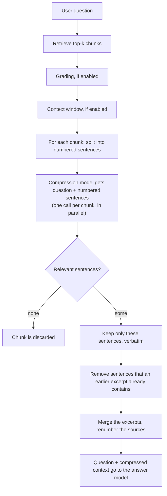

# Contextual compression

Retrieved chunks are written for readers, not for one question: next to the sentence that answers it
there are introductions, transitions, side remarks, and the same fact again in the next chunk. All of it
costs tokens and distracts the answer model. **Contextual compression** removes it at question time: a
model reads every retrieved chunk together with the question and keeps **only the sentences that are
relevant for the question**. A chunk without a relevant sentence is dropped completely.

It is a switch **per crate** (Settings → **Context compression**, or `contextCompression` in the
[REST API](../api.md)), off by default, and takes effect immediately because nothing is re-indexed.

## How it works

1. The question arrives and the top-k chunks are retrieved (with all the usual options such as hybrid search, HyDE, reranking).
2. Optional [grading](grading.md) and the [context window](context-window.md) run first, so a window is built and then compressed.
3. For **each chunk** the chunk text is split into sentences and sent, numbered, with the question to the crate's answer model.
4. The model answers with the numbers of the relevant sentences, for example `{"relevant":[2,5]}`; `[]` means nothing is relevant and the chunk is dropped.
5. The chosen sentences become the excerpt of that chunk. Sentences that already appeared in an earlier excerpt (duplicate information, overlapping windows) are removed from later ones; an excerpt that has nothing new left is dropped.
6. The excerpts are merged in their original order, sources and citations are renumbered, and the answer model receives the compressed context and the question.

## Why the model only picks numbers

The compression model never writes text. It selects sentences by number, so the excerpts are always
**verbatim parts of the source**: nothing can be paraphrased, invented or changed, citations still point
at real text, and the output of the model is a few tokens instead of a rewrite of the chunk.

## What it is good for

| Situation | Effect |
|---|---|
| **Large chunks** (long sections, big [context windows](context-window.md)) | Most of a large chunk is background; only a few sentences answer the question. |
| **Questions about specific details** (a number, a flag, a name) | The sentence with the detail is kept, the surrounding prose is not. |
| **Models with a small context window** or expensive tokens | Fewer tokens per answer, so more sources fit into the context budget. |
| **Overlapping or repetitive content** | Duplicate sentences are removed once. |

It helps less for broad "explain how this works" questions, where the connecting prose is the answer, and for
small, focused chunks, where there is little to remove. If answers get thinner, switch it off or use larger sources.

## What is not compressed

* **Code.** A chunk that contains a code block is used unchanged; cutting code apart would break it.
* **Failures.** If the model call fails or its reply is unusable, that chunk is used unchanged (fail-open); compression never makes an answer fail.
* **Very long chunks** with more than 300 sentences are used unchanged.
* **Unavailable answer model.** Compression is skipped.

Compression applies to answers only (chat, answers API, the OpenAI-compatible endpoint, MCP `ask_crate`). Search
results are not compressed.

## Cost and latency

One extra, small model call per retrieved chunk for every answer. The calls run in parallel (4 at a time), so
the delay is roughly a few model round trips, and it comes before the first token of the answer. The saving is
on the main answer call: it reads fewer tokens. Compression pays off when the chunks are large or the answer
model is the expensive part; for tiny chunks and fast models it mostly adds latency.

## Interplay with other options

* [**Grading**](grading.md) drops whole chunks first; compression then trims the remaining ones. Both can be on.
* [**Context window**](context-window.md) enlarges each match with its neighbours, compression cuts the window down to what matters. Together they let a match be found in a small chunk and read in context, without sending the whole context.
* [**Answer verification**](answer-verification.md) and [**RAG evaluation**](evaluation.md) see the compressed context, because that is what the answer model was given.
* Source `snippet` and citations still refer to the original chunk and document.

## Observability

| Metric | Meaning |
|---|---|
| `answer_compression_chunks_total{outcome}` | Per chunk: `compressed`, `unchanged`, `discarded`, `duplicate`, `skipped`, `failed` |
| `answer_compression_kept_ratio` | Share of the characters that remained (per answer) |
| `answer_compression_characters_saved` | Characters removed from the context (per answer) |
| `answer_compression_duration_seconds` | Time spent compressing the chunks of one answer |
| `llm_requests_total{purpose="compress"}` | Model calls and their outcome |

The Grafana dashboard has a **Context compression** row with these. See [Operations](../operations.md#metrics).

## Tuning

* Answers miss details: the model drops too much. Use a stronger answer model, or switch compression off.
* No latency budget: use it only with a fast answer model, or turn on grading instead, which makes one cheap yes/no call per chunk.
* Many `failed` outcomes: the answer model returns text that is not the requested JSON; check the model and its endpoint.
