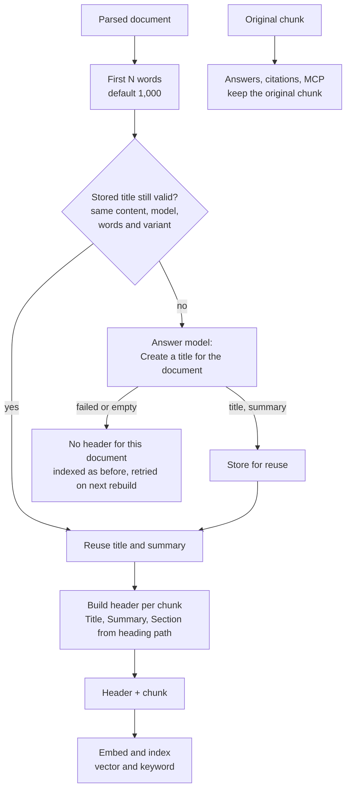

# Contextual chunk headers

A chunk is cut out of its document, and with that it often loses what it is about. The sentence
*“Restart it after changing the certificate.”* means nothing without knowing that the document is
the TLS guide for Nginx. Contextual chunk headers give every chunk that missing context **before it
is embedded**: the answer model writes a title for each document, and the title (optionally with a
summary and the section path) is placed in front of every chunk of that document.

```text
Title: On-Call Strategy for engineers
Summary: How the platform team rotates on-call duty and escalates incidents.
Section: Handbook > Escalation > Pager rules

Page the secondary on-call if the primary does not acknowledge within five minutes.
```

The **whole text above**, header and chunk, is what the embedding model turns into a vector and what
the keyword index stores. A search for *“on-call escalation”* now finds the chunk even though
those words are not in the chunk itself.

The option is set **per crate** on the crate's **Settings** page, section **Contextual chunk
headers**, or with `contextHeaderVariant` in the [REST API](../api.md). It is off by default.

## The three variants

| Variant | Header | Model output |
|---|---|---|
| **Off** (`off`) | None. Chunks are embedded as they are. | – |
| **Title** (`title`) | `Title:` | A title of at most 12 words |
| **Title and summary** (`title-summary`) | `Title:` and `Summary:` | A title and a one or two sentence summary |
| **Title, summary and sections** (`title-summary-sections`) | `Title:`, `Summary:` and `Section:` | Same as above; the section line needs no model |

The **section** line is the chunk's own heading path, for example `Guide > Setup > Linux`. It is
taken from the document structure (see [Chunking](chunking.md#chunk-metadata)), not from the model,
so it is exact and free. Chunks without a heading simply get no section line. For source code the
heading is the file name or symbol, so the line then shows where in the file the code is.

Which one to choose:

- **Title** is the cheapest and fixes most “what is this document about” problems.
- **Title and summary** helps when the title is too short to carry the topic, for example in long
  reference documents with many similar pages.
- **Title, summary and sections** is the best choice for long documents with many subheadings. Two
  chunks from different sections of the same manual then differ in their embeddings, which
  improves ranking between them.

## How it works



1. When a document is indexed, the first **N words** of its body are taken (default **1,000**,
   configurable from 100 to 5,000 per crate).
2. They are sent to the answer model with the instruction to *create a title for the document*
   (and, for the summary variants, a short summary). The text is passed as untrusted data, never as
   instructions.
3. The result is stored with a fingerprint and reused as long as the document content, the answer
   model and endpoint, the number of words and the variant are unchanged.
4. For every chunk the header is built and put in front of the chunk's retrieval text.
5. The combined text is embedded and written to the vector and keyword index.

## The header is for search only

The header changes **what is indexed**, not **what is returned**:

| Where | Text |
|---|---|
| Embedding and vector index | Header + chunk |
| Keyword index (BM25) | Header + chunk |
| Reranking | Header + chunk, as stored for retrieval |
| Answer generation, [grading](grading.md), [verification](answer-verification.md) | The **original chunk** |
| Citations, source list, document view, MCP results | The **original chunk** |

This keeps the prompt small, stops the model from quoting generated titles as if they were source
text, and means a bad title can lower a chunk's ranking but never put wrong content into an
answer. It is the same split that [code chunks](chunking.md#chunk-metadata) already use for their
language and symbol.

## Interaction with other features

- **[Proposition retrieval](retrieval.md):** propositions are written to be understandable on
  their own, so they receive no header. A chunk indexed through the `embed-source-chunk` fallback
  policy does.
- **[HyDE](hyde.md):** works together. HyDE embeds a hypothetical answer, which is then compared
  with header-enriched chunk vectors.
- **[Query transformation](query-transformation.md), reranking:** unchanged.
- **Chunk size:** the header adds up to about 900 characters to the text that is embedded. If an
  embedding endpoint rejects an input as too large, ContextCrate re-chunks with that reserve taken
  into account. For providers with small limits, prefer the *title* variant.
- **Images:** image chunks get the header too, so they are found through their document's topic.

## Changing the setting

Switching the variant or the number of words **rebuilds the index of the crate in the background**.
Search keeps using the old index until the new one is complete. Titles that are still valid are
reused, so only documents whose variant, words, content or model changed cost a model call. Changing
the answer model or endpoint of a crate that uses headers also rebuilds, because the stored titles
no longer match.

## Cost, latency and privacy

- **One answer-model call per document**, not per chunk. A rebuild of a crate with 5,000 documents
  makes up to 5,000 calls the first time and (nearly) none after that.
- Each call sends at most N words (about 1,300 tokens for the default 1,000 words) and receives a
  few dozen tokens. Indexing is slower by one model round trip per new or changed document.
- The **first words of every document are sent to the configured answer provider**. If documents are
  confidential, use a provider you operate or trust, and TLS. The title and summary are stored in the
  crate database next to the document, never written to the audit log, and deleted with the document.
  They are not part of crate exports; they are generated again when the imported documents are
  indexed.
- The header makes embeddings slightly more expensive because the text is longer.

## Failure behavior

The feature is fail-open. A missing header never stops indexing.

| Situation | What happens |
|---|---|
| The answer model is not configured or unavailable | The document is indexed without header. Counted as `failed`. |
| The model call fails or times out | Same. |
| The reply is empty or has no usable title | Same. |
| The reply is longer than expected | Title is cut at 150 and summary at 500 characters. |

Failures are not stored, so the next rebuild or re-ingestion tries again. Check the `failed`
counter after enabling the feature on a large crate.

## Configuration

| Where | Setting |
|---|---|
| Crate **Settings → Contextual chunk headers** | Variant (Off, Title, Title and summary, Title summary and sections) and **Words sent to the model** |
| REST API | `PUT /api/v1/crates/{crateId}/settings/rag` with `"contextHeaderVariant": "title-summary"` and `"contextHeaderWords": 1000`. Omitted fields keep their value. |
| Backup | Both fields are part of the exported RAG settings. Older exports import as `off` and 1,000 words. |

The feature uses the crate's OpenAI-compatible answer endpoint, model, credentials and timeout, and
the crate's embedding provider.

## Observability

| Metric | Meaning |
|---|---|
| `contextcrate_ingestion_context_header_total{variant,outcome}` | Documents by outcome: `generated` (new title), `cached` (stored title reused) or `failed` (indexed without header). |
| `contextcrate_ingestion_context_header_duration_seconds{variant}` | Time per document, including the model call. |
| `contextcrate_ingestion_context_header_length` | Characters of generated title and summary per document. |
| `contextcrate_llm_requests_total` / `llm_duration_seconds` with `purpose="context_header"` | The model calls, next to `grade`, `answer`, `verify`, `revise`, `transform` and `hyde`. |

The Grafana dashboard shows outcomes, generation time and text length in the **Ingestion &
pipeline** section.

## Troubleshooting

| Symptom | Likely cause | What to do |
|---|---|---|
| No change after switching on | The index is still rebuilding | Wait for the rebuild to finish; it runs in the background |
| Many `failed` outcomes | The answer model is down, not configured, or returns unusable replies | Check the provider settings and `llm_requests_total{purpose="context_header"}` |
| Titles are in the wrong language or too generic | The first words of the document are boilerplate (cookie notice, table of contents) | Exclude those parts in the source, or raise the number of words |
| Embedding errors “input too large” after enabling | The provider's limit is small and the header adds text | Use the *title* variant, or set **Maximum input characters** on the embedding provider |
| Search quality got worse for exact identifiers | Long summaries dilute the vector of short code chunks | Use *title* only, or keep hybrid mode so the keyword leg still matches exact terms |
| Rebuild is slow | One model call per document on first use | Expected once; later rebuilds reuse stored titles |
