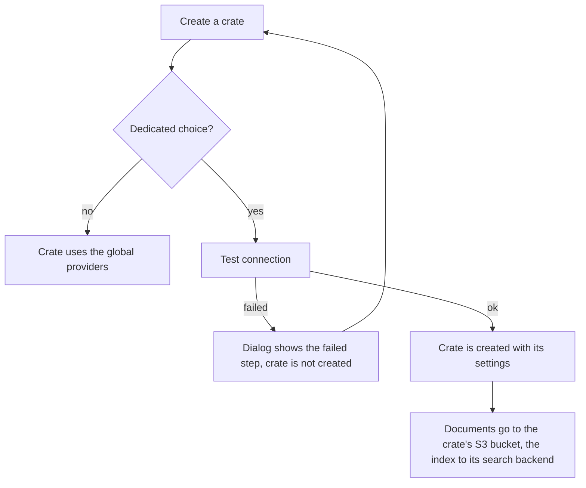

# Dedicated storage and search per crate

By default every crate of an installation keeps its downloaded documents in the installation's **artifact storage** (a local
directory or an S3 bucket) and its search index in the installation's **search backend** (Lucene, OpenSearch, Elasticsearch,
Qdrant or pgvector, see [Search backends](../search-backends.md)). That stays the default and needs no setup.

An administrator can allow crate creators to choose something else **when they create a crate**:

* **Dedicated storage:** the crate's documents go to an S3-compatible bucket of its own (AWS S3, MinIO, Ceph, Cloudflare R2, ...).
* **Dedicated search backend:** the crate's search index lives in an OpenSearch, Elasticsearch, Qdrant or PostgreSQL/pgvector service of its own.

The two are independent: a crate can have only one of them, both, or neither. Everything else (retrieval options, models, members, API) works the same.

## Allowing it (administrators)

Both options are **off by default**. Turn them on in **Administration → Policies → Dedicated storage and search**:

| Policy | Effect |
|---|---|
| Crates may use their own S3-compatible storage | The create dialog offers "Custom S3 storage" |
| Crates may use their own search backend | The create dialog offers "Custom search backend" |

The REST equivalent is `PUT /api/v1/admin/settings/backend-policy` with `{"allowCustomStorage": true, "allowCustomSearchBackend": true}`.
Turning a policy off does not affect crates that already have a dedicated backend; it only hides the choice for new crates.

## Choosing it (crate creators)

The **Create a crate** dialog shows the choices only when the administrator allowed them. Both default to the installation's providers:

* **Document storage:** *Global storage provider* or *Custom S3 storage* (endpoint, region, bucket, access key, secret key, optional folder in the bucket, path-style addressing).
* **Search backend:** *Global search backend* or *Custom search backend*, with a backend (OpenSearch, Elasticsearch, Qdrant, PostgreSQL with pgvector), its endpoint or JDBC URL, credentials and an optional prefix.

Each custom section has a **Test connection** button that shows the result step by step. ContextCrate runs the same test again when you press **Create crate**,
and the crate is **not created** if it fails; the dialog keeps your input, shows the failed step, and you can correct it.



### What the tests check

| Storage test | Search backend test |
|---|---|
| Settings are complete and the endpoint is allowed | Settings are complete and the endpoint is allowed |
| The endpoint answers | The server answers and accepts the credentials (version shown; for pgvector the extension must be available) |
| The credentials are accepted and the bucket exists | An index, collection or table can be created and a document with a vector written |
| An object can be written | Keyword search finds the document |
| It can be read back unchanged | Vector search finds the document |
| It can be deleted | Everything is removed again |

The tests use temporary objects and a throwaway index; they never touch real data. A test is limited to a few seconds per step (40 seconds for the search backend).
ContextCrate does **not** create the bucket for a crate: it must exist, so that a typo in the name cannot silently create a bucket in someone else's account.

## Fixed after creation

The choice cannot be changed later. Moving a crate that already holds documents between storages or indexes is a migration of its own, so a crate keeps what it was created with.
The crate's **Settings → Storage & search** page shows the configuration (endpoint, bucket, prefix, access key, and whether a secret is stored, never the secret itself)
and a **Test connections** button to check that it still works. If the settings of a crate are wrong, create a new crate and [export and import](../backup-migration.md) the content.

## Security

* **Endpoints are checked.** A crate creator can make the server connect to an address, so dedicated endpoints follow the crawler's rule: addresses in private networks, loopback, link-local and the cloud metadata service are refused unless `contextcrate.crawler.allow-private-networks` is on. For pgvector the host of the JDBC URL is checked. This applies to the test and to the creation.
* **Only people who may create crates can test.** The test endpoints need the creation right and the matching policy, so they cannot be used to probe the network.
* **Secrets** (S3 secret key, API keys, passwords) are stored with the crate like the keys of custom model endpoints, are write-only in the UI and the API, and are never returned or logged. Use credentials that can only reach what the crate needs: a key limited to one bucket, a database user that owns only the index schema.
* **Credentials are not exported.** A crate export contains its content, not its dedicated backend settings. An import creates a crate on the installation's global providers.
* **Deleting a crate** removes its objects under `crates/{crateId}/` from its own bucket and its index from its own backend, like for the global providers.

## Layout in the bucket

Objects are stored under `{folder}/crates/{crateId}/runs/...`. Use a folder when several systems share a bucket. With a dedicated bucket the folder is optional.
The key needs these rights: list, get, put and delete objects in the bucket.

## REST API

```http
POST /api/v1/crates
{
  "name": "Handbook",
  "description": "Team handbook",
  "storage": { "mode": "S3", "endpoint": "https://s3.example.com", "region": "eu-west-1", "bucket": "handbook", "prefix": "contextcrate",
               "accessKey": "…", "secretKey": "…", "pathStyle": true },
  "searchBackend": { "mode": "CUSTOM", "backend": "elasticsearch", "endpoint": "https://es.example.com:9200", "apiKey": "…", "prefix": "handbook" }
}
```

`mode` is `GLOBAL` (or the object is omitted) for the installation's provider. A refused configuration answers `422` with `field` (`storage` or `searchBackend`), `error` and the failed `steps`.

| Request | Purpose |
|---|---|
| `POST /api/v1/crates/test-storage` | Test a storage configuration (body as `storage`) |
| `POST /api/v1/crates/test-search-backend` | Test a search backend configuration (body as `searchBackend`) |
| `GET /api/v1/crates/{crateId}/backends` | The crate's configuration without secrets (owners) |
| `POST /api/v1/crates/{crateId}/backends/test` | Test the stored configuration again (owners) |

Both test endpoints answer `{"ok": true|false, "steps": [{"id", "label", "status": "OK|FAILED|SKIPPED", "detail"}]}`.
