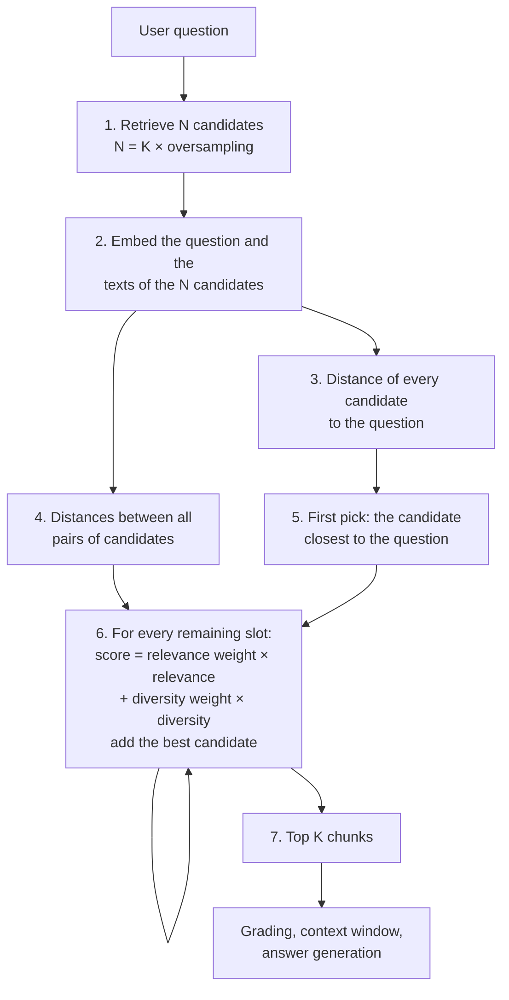

# Dartboard retrieval

Plain retrieval returns the **K most similar chunks**. When a crate holds the same information more than
once (the same page in two sources, overlapping chunks, a manual and its changelog), these K chunks are
often near-duplicates. They fill the prompt with one fact repeated and leave no room for the others.

Dartboard retrieval selects the K chunks differently. It first retrieves **more candidates than needed**
and then chooses K that are **relevant for the question** and, at the same time, **different from each
other**. The name comes from throwing darts: the first dart goes at the target (the question), and every
next dart should land close to the target but not on top of the darts already thrown.

It is switched on **per crate** (default: off) on the crate's **Settings** page, section
**Dartboard retrieval**, or with `dartboardEnabled` in the [REST API](../api.md). It works at question
time only, so switching it on or off never rebuilds the index.

## How it works



1. **Retrieve N candidates.** The normal search (keyword, semantic, hybrid or fusion) runs with
   `N = K × oversampling factor` instead of K, at most 100. K is the number of sources of the answer.
2. **Embed.** The question and the text of every candidate are embedded with the crate's embedding
   provider. For a chunk this is the text that was indexed (including a
   [contextual header](contextual-headers.md), if there is one).
3. **Distance to the question.** For every candidate, the **cosine distance** (1 minus cosine
   similarity) to the question is calculated.
4. **Distances between candidates.** The same distance is calculated for every pair of candidates.
5. **First pick.** The candidate with the smallest distance to the question is chosen first. It is
   always the best match.
6. **Fill the remaining slots.** For every candidate that is not chosen yet, two scores are calculated
   and combined; the candidate with the highest combined score is added:

   | Score | Meaning |
   |---|---|
   | **Relevance** | How close the candidate is to the question. Higher is closer. |
   | **Diversity** | How far the candidate is from the chunks that are already chosen, measured to the *nearest* chosen chunk. A near-duplicate of a chosen chunk gets a low value. |
   | **Combined** | `relevance weight × relevance + diversity weight × diversity` |

7. **Return the top K** chunks in the order they were chosen.

The result is a set of sources that all fit the question, but each adds something the others do not.

## The formulas

With cosine distance `d` and the smoothing parameter `σ` (sigma):

```text
relevance(c)  = − d(question, c)² / (2σ²)
diversity(c)  = − log Σ over chosen chunks s of exp( − d(c, s)² / (2σ²) )
combined(c)   = relevanceWeight × relevance(c) + diversityWeight × diversity(c)
```

Relevance is the logarithm of a Gaussian bell curve around the question: the closer the candidate, the
higher the value. Diversity is a *smooth minimum* of the squared distances to the chosen chunks, so it
is high only when the candidate is far from **all** of them, and low as soon as it is close to one.
Everything is calculated in log space, so even a small sigma does not cause numeric underflow.

## Sigma

`σ` is the optional **smoothing parameter** (0.01 to 1, default **0.1**).

- **Small σ** (for example 0.05): the diversity of a candidate is decided by the **nearest** chosen
  chunk only. This is strict: one close neighbour is enough to push a candidate down.
- **Larger σ** (for example 0.5 to 1): the diversity is smoothed over **all** chosen chunks. A candidate
  that is moderately close to several chosen chunks is penalised more than one that is close to a single
  chunk. Choices become less sharp and the weights matter more.

Sigma changes *how* the distance to the chosen chunks is combined. It does not change the order of the
candidates by relevance alone. The default 0.1 fits the usual range of cosine distances between passages
of a text embedding model (about 0.1 to 0.6); the default is a good starting point and rarely needs a change.

## Settings

| Setting | Range | Default | Meaning |
|---|---|---|---|
| **Enabled** | on / off | off | Switch for the crate |
| **Oversampling factor** | 2 to 10 | 3 | Candidates = K × factor, at most 100. More candidates give more choice and cost more embeddings. |
| **Relevance weight** | 0 to 10 | 1.0 | Weight of the closeness to the question |
| **Diversity weight** | 0 to 10 | 1.0 | Weight of the distance to the chunks already chosen |
| **Sigma** | 0.01 to 1 | 0.1 | Smoothing, see above |

The weights are not both allowed to be 0. Useful points:

- Diversity weight **0** gives the plain top K by closeness to the question.
- Raise the **diversity weight** (for example 2) when the sources still repeat each other. Lower it
  (for example 0.5) when answers lose important detail.
- Relevance weight 0 chooses the most spread-out chunks after the first pick. This is rarely a good
  idea for answering.

## When to use it

It helps when:

- The crate contains **overlapping or repeated content** (several versions of a document, the same text
  from a website and from a Git repository, FAQ and handbook that say the same).
- Questions are **broad** ("how does X work?") and the answer needs several different aspects.
- You see the same fact several times among the sources of an answer.

It helps less, or is not worth it, when:

- The crate is **small**: there are hardly more candidates than K.
- Questions look for **one exact passage**, such as an error code or a function name. The nearest chunk
  is the answer, and diversity can only push a good second chunk out.
- Lexical retrieval mode is used: there are no vectors, so dartboard retrieval is skipped.

## Combining with other features

| Feature | Interplay |
|---|---|
| [Retrieval modes](retrieval.md) | Works with semantic, hybrid and fusion. Skipped in lexical mode. The candidates come from the mode you chose; only the final choice uses embedding distances. |
| [Reranking](../reranking.md) | The reranker runs inside the search and orders the N candidates. Dartboard then chooses K by embedding distance, so its first pick is the candidate **closest in embedding space**, which can differ from the reranker's top hit. If your reranker is much better than the embedding model, keep the diversity weight high and the oversampling low. |
| [Hierarchical retrieval](hierarchical-retrieval.md) | Independent and combinable: hierarchical retrieval narrows the chunk search to the best sections, and dartboard chooses K of the chunks found there. |
| [Query transformation](query-transformation.md) | The lists of all transformed queries are fused first (with the oversampled limit), then dartboard chooses K from the fused list, with the **original question** as the target. |
| [HyDE](hyde.md) | HyDE changes only the vector search of the candidates. The choice uses the original question. |
| [Document enrichment](document-enrichment.md) | Candidates that are generated questions or propositions are represented by their chunk text, so two records of one chunk count as duplicates. |
| [Grading](grading.md), [context window](context-window.md), [compression](contextual-compression.md) | They run after the choice, on the K chunks. |

## Failure behavior

Dartboard retrieval is fail-open. An answer is never blocked because of it.

| Situation | What happens |
|---|---|
| The feature is off | Normal retrieval with K candidates. |
| Lexical retrieval mode | The feature is skipped; the search is not oversampled. |
| Embeddings are not available | Skipped; the search is not oversampled. |
| Embedding the question or candidates fails (error, timeout, a text too long for the model) | The first K candidates of the normal ranking are used. Counted as `error`. |
| Fewer candidates than K, or only one | They are returned as they are. |
| A candidate has a zero vector | It is treated as unrelated to everything (distance 1). |

## Cost and latency

- **No language-model call.** The choice is a calculation: for N candidates, N² distances of a few
  hundred numbers each, which takes well below a millisecond to a few milliseconds.
- **One extra embedding request per question** for the N candidate texts (about 9 to 30 passages with the
  default factor 3), in one batch, plus the question. With a local model this is fast; with a remote
  provider, expect the latency of one embedding call. The candidate texts are sent to the embedding
  provider again, like the question is, so treat it as a data processor.
- The search itself retrieves N instead of K results, which is slightly more work.

## Configuration

| Where | Setting |
|---|---|
| Crate **Settings → Dartboard retrieval** | The **Enabled** switch, **Oversampling factor**, **Sigma**, **Relevance weight** and **Diversity weight**. |
| REST API | `PUT /api/v1/crates/{crateId}/settings/rag` with `dartboardEnabled`, `dartboardOversampling`, `dartboardRelevanceWeight`, `dartboardDiversityWeight` and `dartboardSigma`. Omitted fields keep their value. Out-of-range values are rejected with `400`. |
| Backup | All five values are part of the exported RAG settings. Older exports import with the defaults (off). |

It needs an enabled embedding provider for the crate. The number of sources K is the crate's
**source limit** (or `maxSources` of the request, if lower).

## Observability

| Metric | Meaning |
|---|---|
| `contextcrate_answer_dartboard_total{outcome}` | Selections by outcome: `applied`, `skipped` (embeddings unavailable) or `error` (fell back to the normal ranking). |
| `contextcrate_answer_dartboard_duration_seconds` | Time of the selection including the embedding calls. |
| `contextcrate_answer_dartboard_candidates` | Number of candidates per selection. |

## Troubleshooting

| Symptom | Likely cause | What to do |
|---|---|---|
| Sources did not change | The feature is off, the mode is lexical, or the outcome is `error` | Check the settings and `answer_dartboard_total` |
| Many `error` outcomes | The embedding provider is down, slow, or rejects the candidate texts | Check the embedding settings; see the log for `Dartboard selection failed` |
| Sources are varied but off-topic | The diversity weight is too high, or oversampling too large | Lower the diversity weight or the oversampling factor |
| Sources still repeat | The weight is too low, sigma too large, or the duplicates are not similar in the embedding space | Raise the diversity weight or lower sigma |
| Answers got slower | One more embedding call per question | Use a faster embedding model, or lower the oversampling factor |
