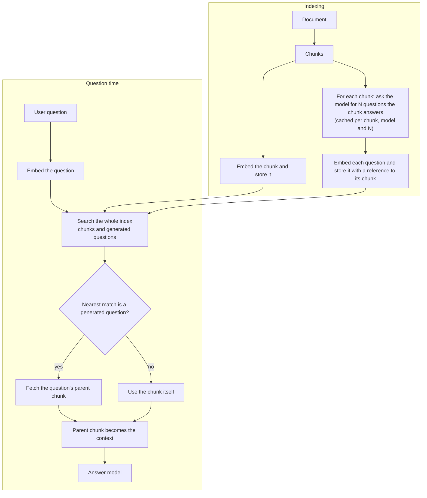

# Document enrichment

A user asks *"who is on call this week?"*; the handbook says *"Engineers hand the pager over every Monday morning."*
The question and the passage share almost no words, and even their embeddings are only loosely related, because a
question and an answer do not look alike. [HyDE](hyde.md) closes this gap at question time by turning the question into
a hypothetical document. **Document enrichment** closes it the other way round, at indexing time: for every chunk a
model writes the **questions that the chunk can answer**, and these questions are indexed next to the chunk.

At question time the user's question is therefore compared with *questions*, which look like it. When the nearest match
is a generated question, the chunk it belongs to is retrieved and used as context. The model that answers never sees the generated questions, only the real chunk.

It is a switch **per crate** (Settings → **Document enrichment**, or `enrichmentEnabled` and `enrichmentQuestions` in the
[REST API](../api.md)), off by default.

## How it works

1. The document is split into chunks as usual (any [chunking](chunking.md) strategy, including [semantic chunking](semantic-chunking.md)).
2. For **each chunk** the crate's answer model is asked to write N distinct questions that the chunk answers, from different angles (facts, reasons, steps, definitions, numbers).
3. The chunk itself is embedded and stored, exactly as without enrichment.
4. **Each question** is embedded and stored as its own index record that points at the chunk. Questions are embedded the way user questions are (the same prefix a query gets), so question-to-question similarity is as direct as it can be.
5. At question time the user's question is embedded and the whole index is searched, chunks and generated questions together. The keyword leg of a hybrid search also looks at the question text.
6. If the best match of a chunk is one of its generated questions, the **parent chunk** is returned. A chunk appears once in the result even when several of its questions match.
7. The parent chunk, with its original text, is what reranking, grading, the [context window](context-window.md), [compression](contextual-compression.md) and the answer model work with. Snippets show the chunk, not the question.

## How many questions

**3 to 50 per chunk, default 5.** Every question is another way to ask for the same passage, so more questions raise
the chance that a differently phrased question lands close to one of them. They also make ingestion slower, the index larger,
and, in a long document, can crowd the nearest-neighbour candidate list with questions of the same chunk (the result
is still deduplicated to one entry per chunk). Start with 5; raise it for large chunks that cover many facts, lower it for short, focused chunks.
The model is asked for exactly the configured number; if it returns more, the first N distinct questions are kept, fewer are accepted.

## Cost and behaviour

* **Ingestion:** one model call per chunk and (N + 1) embeddings per chunk instead of one. A crate of 10,000 chunks at N = 5 means 10,000 model calls and 60,000 embeddings.
* **Caching:** the questions are stored with a fingerprint of the chunk text, the answer model and N. Index rebuilds reuse them; only new or changed chunks call the model again. Changing N or the answer model generates new questions.
* **Changing the setting** switches the index to a new generation in the background (like [contextual headers](contextual-headers.md)); the old index keeps serving until the new one is ready.
* **Failures are fail-open:** when the model is unreachable or returns nothing usable, the chunk is indexed without questions and tried again on the next rebuild. Ingestion never fails because of enrichment. Watch the failed counter.
* **Not enriched:** image-description chunks and chunks shorter than 40 characters.
* **Query time costs nothing extra:** there is no model call when a question is asked, only the larger index is searched.

## Enrichment, HyDE and friends

| | When it runs | What is embedded | Cost |
|---|---|---|---|
| [HyDE](hyde.md) | Every question | A hypothetical answer, written for the question | One model call per question |
| **Document enrichment** | Once, at indexing | The chunks and N questions per chunk | One model call per chunk, a larger index |
| [Proposition retrieval](retrieval.md) | Once, at indexing | Atomic statements instead of the chunk | Model calls per chunk, graded |
| [Contextual headers](contextual-headers.md) | Once, at indexing | Title / summary in front of the chunk | One model call per document |

They can be combined. Enrichment adds question records to whatever the other options index; HyDE then searches that index with a hypothetical answer, which still matches the chunk or proposition records.
Enrichment suits crates where users ask questions in their own words (support, handbooks, FAQs-from-documentation); HyDE needs no re-indexing and suits crates that are already indexed.

## Seeing the questions

* The document details page lists the generated questions under every chunk.
* `GET /api/v1/crates/{crateId}/documents/{documentId}/chunks/{chunkId}/questions` returns them.
* Grafana row **Document enrichment**: questions per chunk, outcomes, and how often a generated question was the best match.

## Observability

| Metric | Meaning |
|---|---|
| `ingestion_enrichment_chunks_total{outcome}` | Per chunk: `generated`, `cached`, `skipped`, `failed` |
| `ingestion_enrichment_questions` | Questions per generated chunk |
| `ingestion_enrichment_duration_seconds` | Time to enrich the chunks of one document |
| `search_top_match_total{type,leg}` | Type of the best match of a search leg: `chunk`, `question`, `proposition` or `document` |
| `llm_requests_total{purpose="questions"}` | Model calls and their outcome |

See [Operations](../operations.md#metrics).

## Tuning

* Many `failed` outcomes: the answer model does not return the requested JSON, or is unreachable; check the model and its endpoint.
* `search_top_match_total{type="question"}` close to 0: users already ask in the document's words, or N is small; enrichment may not pay off.
* Good recall but noisy results: lower N, or add [grading](grading.md).
