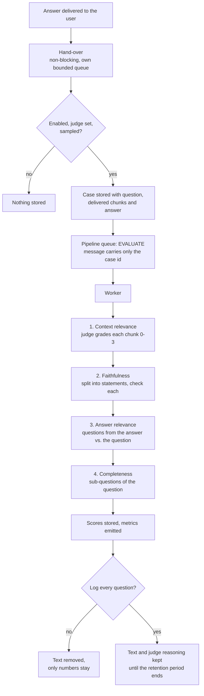

# RAG evaluation

You cannot tune what you cannot measure. RAG evaluation scores the answers your crate gives along
three axes, in the background, with a separate **judge model**, and shows the numbers on a Grafana
panel and on an **Evaluation** page in the crate (visible to crate owners only). It is built for tuning: change the chunk size,
switch on [HyDE](hyde.md) or [contextual headers](contextual-headers.md), and see what happens to the
scores.

| Axis | Question it answers | Compares | Scores |
|---|---|---|---|
| **Context relevance** | Did retrieval find the right chunks, and in a good order? | question ↔ retrieved chunks | Precision@K, Recall@K, MRR, MAP, NDCG |
| **Faithfulness** | Is the answer grounded in what was retrieved? | retrieved chunks ↔ answer | Faithfulness |
| **Answer relevance** | Does the answer address the question, and completely? | question ↔ answer | Answer relevance, Completeness |

Evaluation is **off by default**, is switched on **per crate by the crate owner**,
and never changes or delays an answer.

## How it runs



1. When an answer has been generated (chat, `POST …/answers`, the OpenAI-compatible endpoint and the
   MCP tool `ask_crate` all count), the answer service hands it over and returns immediately. The
   hand-over uses a small bounded queue of its own. If it is full, the answer is not evaluated and a
   counter goes up; the answer itself is never affected.
2. If evaluation is enabled for the crate, a judge model is configured and the answer is selected by
   the **sampling rate**, a case is stored and a message for the pipeline stage `EVALUATE` is queued.
3. A worker (role `all` or `indexer`) evaluates the dimensions **one after another**, each with its
   own judge calls, and stores the scores.
4. Without per-question logging the text is removed right away and only the numbers remain.

## The judge model

The judge is configured **per crate and separately from the answer model**, by the crate owner, just
like the answer model: either a **shared model of type “Judge for RAG evaluation”** (created by an
administrator under Administration → Models, optionally as the default for new crates) or an own
OpenAI-compatible endpoint with model and API key. A stronger model than the answer model usually
gives more reliable scores; the judge is used wherever a number cannot be computed from the data
itself (relevance of a chunk, support of a statement, coverage of a sub-question).

Every prompt follows the same protocol, which keeps the scores comparable:

- **One dimension per call.** Relevance, support, similarity and coverage are never asked together.
- **Reasoning first, then the score.** The judge must explain in one to three sentences, then give
  the score: `{"reasoning": "…", "score": 2}`.
- **Coarse scales.** 0 to 3 for relevance, 0 to 2 for coverage and 0 or 1 for yes/no questions, never
  a 1 to 100 scale. Coarse scales are far more consistent between runs.
- **Untrusted data.** Question, chunks and answers are passed as data, never as instructions.
- Temperature 0. A reply that is not usable is asked for once more; after that the dimension is
  recorded as failed and the other dimensions are not affected.

## Context relevance

The judge grades every retrieved chunk for the question: **0** irrelevant, **1** marginal, **2**
relevant, **3** highly relevant. Grades of 2 and 3 count as *relevant*. The grades are turned into
ranking metrics for the top **K** chunks (K is a setting, default 5, and at most the number of chunks
delivered).

| Metric | Definition | Reads as |
|---|---|---|
| **Precision@K** | relevant chunks in the top K ÷ K | How much of what the model sees is useful |
| **Recall@K** | relevant chunks in the top K ÷ all relevant chunks that exist | How much of the useful material was found |
| **MRR** | 1 ÷ rank of the first relevant chunk (average over questions) | How early the first good chunk appears |
| **MAP** | average of the precision at each relevant rank ÷ all relevant chunks (average over questions) | Quality of the whole ordering |
| **NDCG@K** | discounted gain with gain 2^grade − 1, divided by the best possible ordering | Whether the best chunks are on top, using the 0 to 3 grades |

**How many relevant chunks exist** is the part that cannot be known for free. Two sources are used:

- **Live answers** use the **candidate pool**: the same search is run for the question and its top
  results (default 20, setting *Candidate pool*) are judged once. Recall is then relative to the
  relevant chunks inside this pool. It is an estimate that tells you whether better chunks were
  available but not delivered, not an absolute recall.
- **Golden-set questions** use the documents you declared as expected. Recall@K is then the share of
  expected documents found in the top K, a true recall.

A value that is mathematically undefined (for example recall when the pool holds no relevant chunk)
is left out, not counted as 0 or 1.

**Worked example.** Top 5 grades `[3, 0, 2, 1, 2]`, so 3 relevant chunks; the pool holds 4 relevant
chunks in total. Precision@5 = 3/5 = 0.60. Recall@5 = 3/4 = 0.75. The first relevant chunk is at rank
1, so the reciprocal rank is 1. Average precision = (1/1 + 2/3 + 3/5) ÷ 4 = 0.57.

## Faithfulness

Faithfulness checks whether the answer says only what the retrieved chunks say.

1. The judge splits the answer into **atomic statements**: one fact each, pronouns resolved, hedges and
   citation markers removed (at most 20 statements).
2. For **each statement** a separate call asks whether it is **supported** by the chunks that were
   delivered to the answer model (1) or not (0). The judge may not use its own knowledge.
3. **Faithfulness = supported statements ÷ all statements.**

A low score means the model said things the sources do not back up: tighten the system prompt, enable
[answer verification](answer-verification.md) or [strict grounding](../answers.md), or check whether
[grading](grading.md) removed the chunk that held the fact. An answer without statements is not scored.

## Answer relevance and completeness

**Answer relevance.** The judge writes **three questions the answer clearly answers**. Their
similarity to the original question is the score: an answer that fits the question produces questions
that look like it. Similarity is the cosine similarity of the **crate's embedding model** (clamped to
0–1) and averaged. If embeddings are not available, the judge rates each pair on a 0–3 scale instead
(divided by 3). Off-topic or rambling answers score low.

**Completeness.** The judge breaks the question into up to six **sub-questions** and classifies them:

| Importance | Meaning | Weight |
|---|---|---|
| **Core** | The essential aspects the person asked for | 1.0 |
| **Background** | Supporting context needed to understand the answer | 0.5 |
| **Follow-up** | Extensions a thorough answer would anticipate | 0.25 |

For each sub-question a separate call judges whether the answer addresses it: **0** not, **1**
partly, **2** clearly. **Completeness = Σ weight × (score ÷ 2) ÷ Σ weight.** Missing core aspects hurt
most; missing follow-ups hurt little.

**Reference recall (golden set only).** When a golden question has a reference answer, the reference
is split into statements and the judge checks for each whether the generated answer contains it. The
share found is the recall-like **reference recall**.

## The golden set

The golden set is a list of questions you know the right answer to. It turns the judge-based estimates
into measurements against ground truth, and it gives you a **repeatable benchmark**: run it before and
after a change and compare. Each entry has:

- a **question** (required),
- **expected documents**: text that must appear in the source address of a relevant chunk, for example
  `docs/oncall.md`; one or more per question,
- a **reference answer** (optional).

An entry needs expected documents, a reference answer, or both. Up to 200 questions per crate. Add
them on the evaluation page or import a JSON array:

```json
[
  {
    "question": "How do I escalate an incident?",
    "relevantUris": ["docs/oncall.md", "docs/escalation.md"],
    "referenceAnswer": "Page the secondary on-call if the primary does not acknowledge within five minutes."
  }
]
```

**Run golden set now** queues one case per question. The worker asks each question through the normal
answer path (these internal answers are not evaluated a second time) and scores it with the golden
ground truth. The results appear as a separate *Golden set* line, apart from live traffic.

## Privacy

ContextCrate otherwise does not keep questions or answers. Evaluation needs them for a short time, so
it is designed to hold them as briefly as possible:

- The pipeline message contains **only the id of the case**, never text. Completed messages stay in
  the pipeline table, so this matters.
- The case row holds the question, the delivered chunks and the answer **only until it is evaluated**.
  Then the text is removed and **only the numeric scores remain**.
- Cases that are never evaluated are deleted after **one hour**.
- With **Log every question** the text, the judge's reasoning and the statements are kept for each
  case until the **retention period** ends (default 30 days, then the whole case is deleted).
- The judge model **receives the question, the retrieved chunks and the answer**. Use a provider you
  trust with the content of the crate, with TLS.
- The settings, the scores and the logged text are visible to the **crate owners** only (and to an administrator with an active [elevation](../operations/administration.md)). Editors, viewers and crate API keys cannot see or change anything.
- Evaluation data is not part of crate exports. Settings changes and golden-set runs are written to
  the audit log (never with keys or question text).

## Cost and performance

- Nothing runs on the answer path. The only work there is a hand-over that returns immediately.
- The judge calls per evaluated answer are roughly: **K** (chunk grades) + the **pool size − K**
  extra chunks + **1 + statements** (faithfulness) + **1 + 3** (answer relevance, +3 without
  embeddings) + **1 + sub-questions** (completeness). With the defaults that is on the order of
  **40 to 60 short calls**. Reduce the cost with a lower **sampling rate**, a smaller **candidate
  pool** (set it equal to K to skip the pool), or by switching dimensions off.
- Start with a sampling rate of 0.1 to 0.25 on busy crates. A few hundred evaluated answers give
  stable averages.
- Evaluation shares the workers with ingestion but runs at the lowest priority. In a distributed
  installation it runs on the `indexer` role.

## Settings

All of these are on the crate's **Evaluation** page (sidebar, below Operations, owners only; `/crates/{id}/evaluation`)
or in the [REST API](../api.md).

| Setting | Default | Meaning |
|---|---|---|
| Enabled | off | Evaluate answers of this crate |
| Sampling rate | 1.0 | Share of answers that are evaluated (0.01 to 1) |
| K | 5 | Chunks judged for the ranking metrics (1 to 20) |
| Candidate pool | 20 | Results judged to find all relevant chunks, not below K (up to 100) |
| Dimensions | all on | Context relevance, faithfulness, answer relevance, completeness |
| Log every question | off | Keep text and judge reasoning per case |
| Keep cases | 30 days | Retention of cases (1 to 365) |
| Judge model | – | Shared judge model or own endpoint, model and key; nothing is evaluated without one |

## The evaluation page

The page shows the averages for the last day, week, month or quarter, a **daily trend**, the
**golden-set** results, and the **latest evaluated answers** with their scores. With per-question
logging on, every row expands to the answer, the delivered sources and the
judge's reasoning, so you can read *why* a score is low.

## Metrics and Grafana

| Metric | Meaning |
|---|---|
| `contextcrate_evaluation_context_precision_at_k`, `…_recall_at_k`, `…_mrr`, `…_map`, `…_ndcg` | Context relevance per evaluated answer (average = sum ÷ count) |
| `contextcrate_evaluation_faithfulness`, `…_answer_relevance`, `…_completeness`, `…_reference_recall` | The other scores |
| `contextcrate_evaluation_cases_total{outcome,source}` | `done`, `failed`, `skipped` (not sampled) or `dropped` (hand-over full or error); source `live` or `golden` |
| `contextcrate_evaluation_duration_seconds` | Time to evaluate one answer |
| `contextcrate_evaluation_judge_failures_total{dimension}` | Dimensions whose judge reply could not be used |
| `contextcrate_llm_requests_total` / `llm_duration_seconds` with `purpose="judge"` | The judge calls |

The Grafana dashboard has a **RAG evaluation** section with the averages, the trends, outcomes, the
duration of an evaluation and the judge's latency. Scores are summaries without per-question labels, so
they carry no question text.

## Tuning with the scores

| Low score | Likely cause | What to try |
|---|---|---|
| Precision@K | Noise in the results | [Grading](grading.md), [reranking](../reranking.md), a smaller *maximum sources*, [contextual headers](contextual-headers.md) |
| Recall@K, NDCG | Good chunks exist but rank low or are not delivered | [HyDE](hyde.md), [query transformation](query-transformation.md), hybrid retrieval, a larger source limit, smaller [chunks](chunking.md) |
| MRR | The first useful chunk is far down | Reranking, contextual headers |
| Faithfulness | The model adds facts the sources do not contain | [Answer verification](answer-verification.md), [strict grounding](../answers.md), a stronger answer model |
| Answer relevance | The answer wanders off the question | The system prompt and history handling, [query rewriting](query-transformation.md) |
| Completeness | Parts of the question are not answered | A larger source limit or context budget, [sub-queries](query-transformation.md) |

Change one thing at a time, use the golden set for the comparison, and look at a few hundred answers
before concluding anything.

## Troubleshooting

| Symptom | Likely cause | What to do |
|---|---|---|
| Nothing is evaluated | Evaluation is off, no judge is configured, or the sampling rate is low | Check the page for the “No judge model” notice and the settings |
| Many `failed` outcomes | The judge is down, too small, or does not return JSON | Check `evaluation_judge_failures_total` by dimension and use a more capable judge |
| `dropped` outcomes | The hand-over queue was full (a burst of answers) | Lower the sampling rate |
| Cases stay waiting | No worker with role `all` or `indexer` is running | Check the queue depth of the `EVALUATE` stage in Operations |
| Recall@K is missing | No relevant chunk was found in the pool | Increase the pool, or use a golden set |
| No text in the list | Per-question logging is off, or the case is older than the retention period | Switch on *Log every question* |
