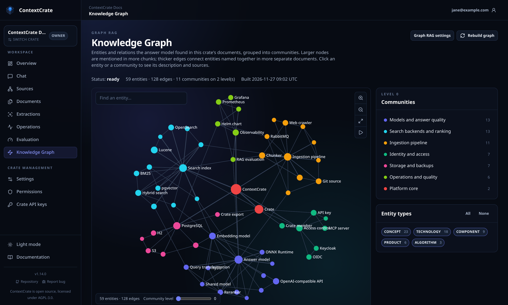
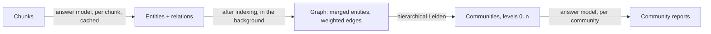
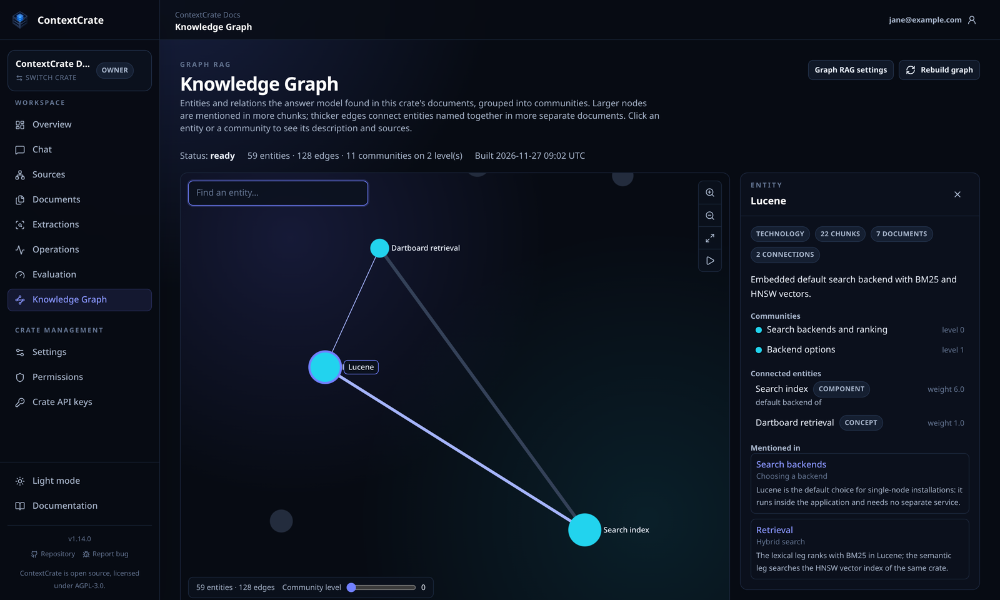
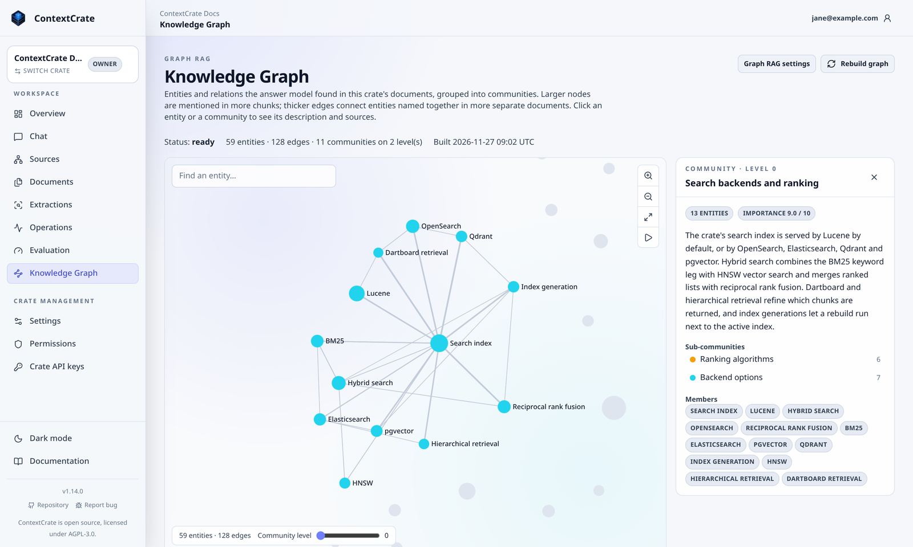

# Graph RAG

Graph RAG builds a **knowledge graph** of a crate and uses it for retrieval. Vector and keyword search find passages that look like the question. The graph can do two other things: follow the relations between entities ("which components depend on the auth service?"), and answer questions about the collection as a whole ("what are the main themes?").

The feature is off by default and configured per crate under Crate settings → Graph RAG. It has two switches:

- **Build knowledge graph** (`graphExtractionEnabled`) extracts entities and builds the graph. Switching it on rebuilds the index so existing chunks are extracted.
- **Use as retrieval strategy** (`graphRetrievalEnabled`) answers questions from the graph, with **Local**, **Global** or **Auto** search (`graphSearchMode`).

The graph is stored in the application database (PostgreSQL or H2). It works with every search backend and needs no extra component.

## How the graph is built

1. **Extraction (while indexing).** The answer model reads every chunk. For each entity it returns a name, a type (e.g. `PRODUCT`, `PERSON`, `COMPONENT`) and a short description. For each relation it returns two entity names, a description and a strength from 1 to 10. There are at most 20 entities and 30 relations per chunk. Results are cached per chunk by a fingerprint of the chunk text and the model, so an index rebuild does not call the model again. A failed chunk is left out of the graph and retried by the next rebuild; indexing itself never fails because of extraction.
2. **Graph (after indexing).** A background job builds the graph as soon as the crate's indexing is idle: no pending or running work items and no index rebuild. The job runs on control-plane nodes, and a database claim makes sure only one node builds a crate at a time.
   - Entities are merged across chunks by their normalised name, ignoring case, accents, punctuation and spacing. Each merged entity gets the most frequent name and type and up to three distinct descriptions.
   - **Hubs:** an entity's size is the number of chunks that mention it, so an entity mentioned in many chunks becomes a large, highly connected node.
   - **Edges** connect entities mentioned in the same chunk. The edge weight is `1 × (number of distinct documents in which both are mentioned) + Σ (relation strength / 10)`. Two entities that appear together in several separate documents therefore get a strong edge.
3. **Communities.** Hierarchical [Leiden](https://www.nature.com/articles/s41598-019-41695-z) community detection partitions the graph by maximising weighted modularity, using local moving, refinement and aggregation. The result is deterministic. Level 0 partitions the whole graph. A community with more than 25 entities is partitioned again on the next level, up to 4 levels. Isolated entities belong to no community.
4. **Community reports.** For every community on every level, the answer model writes a title, a summary of 3 to 8 sentences and an importance rating from 0 to 10.
   - The model works bottom-up. A community whose entities and relations do not fit into the prompt (8,000 characters) is summarised from the reports of its sub-communities.
   - Reports are cached by a fingerprint of their input, so a rebuild only summarises communities that changed.
   - If the model fails, the report falls back to a list of the community's most central entities.

The new graph replaces the stored one only when the build succeeds. A failed build keeps the previous graph and shows the error on the Knowledge Graph page.

## Retrieval

When **Use as retrieval strategy** is on and a graph has been built, graph search replaces the normal chunk retrieval. Query transformation, adaptive retrieval and Dartboard are not applied. Generation stays the same: the answer model gets the original question, the cited sources and an additional *knowledge graph context* block. Grading, context window, compression and verification work as before. If the graph is not built yet or finds nothing usable, the normal retrieval runs.

### Local search

For questions about specific entities or their immediate context:

1. The answer model lists the entities the question refers to. They are matched against the graph, first by exact normalised name and then by containment. If the question names no known entity, the entities of the best matching chunks from a normal search are used as entry points.
2. From the entry entities the graph is traversed outward for two hops, along the strongest edges. Up to 20 entities are collected.
3. The context contains the collected entities with types and descriptions, the relations between them (up to 30), and the report of the entry entities' most specific community. The **original text chunks** are ranked by how many collected entities they mention, and the top `sourceLimit` become the normal, citable sources.

### Global search

For broad questions about themes, patterns and summaries. It uses map-reduce over community reports:

1. **Level selection:** the deepest hierarchy level with at most 40 communities.
2. **Map:** the reports of that level are ordered by importance and sent to the answer model in batches of 8, four batches in parallel. For each batch the model writes partial answers and rates each from 0 to 100 for relevance.
3. **Reduce:** partial answers rated 0 are dropped. The rest are sorted by rating and the highest ones are kept within 8,000 characters. Generation combines them into the answer.

Global search has no chunk sources. Strict grounding therefore checks for either sources or graph context before declining an answer.

### Auto

One short model call decides per question. Questions about specific named things go to local search; questions about the collection as a whole go to global search. If the call fails, local search is used.

## Knowledge Graph page

Workspace → **Knowledge Graph** (visible to every crate member) shows the graph interactively:

- The graph is drawn with WebGL (sigma.js) and laid out with ForceAtlas2. Node size reflects chunk count and edge thickness reflects weight.
- Nodes are coloured by community, and a slider selects the hierarchy level.
- You can zoom in and out, fit the whole graph, and stop or rerun the layout.
- Search finds an entity by name, and entity types can be filtered.
- Clicking an entity shows its type, description, communities, connected entities with relation descriptions, and the chunks it is mentioned in, with links to the documents.
- Clicking a community shows its report, importance, members, parent and sub-communities, and zooms onto its members.
- Owners can schedule a rebuild of the graph.

The view shows the 2,000 most mentioned entities. Larger graphs are marked as truncated.

The screenshots show a fictional example graph.

## Cost

| Step | Model calls |
| --- | --- |
| Indexing | One per chunk; cached, so a rebuild costs nothing for unchanged chunks |
| Graph build | One per changed community |
| Local search | One call to find the entities, plus one for Auto |
| Global search | One per 8 community reports of the chosen level (up to 15 calls), plus one for Auto |

Chunk texts, community reports and questions are sent to the answer provider.

## API

- `PUT /api/v1/crates/{crateId}/settings/rag` accepts `graphExtractionEnabled`, `graphRetrievalEnabled` and `graphSearchMode` (`local`, `global` or `auto`).
- `GET /api/v1/crates/{crateId}/graph?limit=2000` (Viewer) returns the build status, nodes, edges and communities.
- `GET …/graph/entities/{entityId}` and `GET …/graph/communities/{communityId}` (Viewer) return the details.
- `POST …/graph/rebuild` (Owner) schedules a rebuild.

The graph is not part of crate exports; after an import it is rebuilt from the documents.

## Observability

- `ingestion_graph_extraction_chunks_total{outcome}` (`generated`, `cached`, `skipped`, `failed`), `ingestion_graph_extraction_entities`, `ingestion_graph_extraction_duration_seconds`
- `graph_build_duration_seconds{outcome}`, `graph_entities`, `graph_edges`, `graph_communities`, `graph_summaries_total{outcome}`
- `answer_graph_total{mode,outcome}`, `answer_graph_duration_seconds{mode}`, `answer_graph_step_duration_seconds{step}`, `answer_graph_entities`, `answer_graph_partial_answers`
- `llm_requests_total{purpose}` with `graph_extract`, `graph_summary` and `graph_search`

The applied strategy is recorded as `graph:local` or `graph:global` in the `transform=` field of the answer audit entry.
