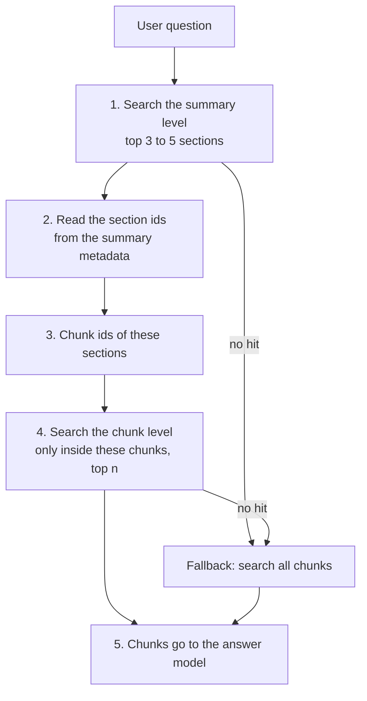

# Hierarchical retrieval

Normal retrieval compares a question with **every chunk** of a crate. In a large crate many chunks look
alike, so the right passage competes with hundreds of similar ones from other parts of the documentation.
Hierarchical retrieval adds a second, coarser level to the index and searches in two steps:

1. Find the **sections** that probably answer the question.
2. Search for chunks **only inside those sections**.

It is switched on **per crate** (default: off) on the crate's **Settings** page, section
**Hierarchical retrieval**, or with `hierarchicalEnabled` in the [REST API](../api.md). Switching it on
rebuilds the index in the background, because the summaries have to be created first.

## What is a hierarchical index?

A *flat* index has one level: all chunks, each with one vector. A *hierarchical* index has several levels
that describe the same content at different sizes. Here there are two:

| Level | Entry | Size | Used for |
|---|---|---|---|
| **Summary level** | One entry per document section: an LLM-written summary | A few sentences | Deciding *where* to look |
| **Chunk level** | One entry per chunk (plus questions or propositions, if enabled) | About 1,000 characters | Finding the exact *passage* |

A summary is short and contains the topics of a whole section, so it matches a broad question better than
any single chunk of that section does. The chunk level then supplies the precise text for the answer.
Every summary knows exactly which chunks belong to its section, so the two levels are linked.

## Sections

ContextCrate has no separate "section" object in the documents, so a section is derived from the heading
structure: **consecutive chunks that share the first two levels of their heading path** form one section.
For example `Handbook > Escalation > Pager rules` and `Handbook > Escalation > Contacts` are both in the
section `Handbook > Escalation`. Text before the first heading is a section of its own. If the same
heading appears again later in the document, it is a new section.

For every section ContextCrate stores its **exact position**:

| Field | Meaning |
|---|---|
| Section id | A stable id derived from the document and the section. It is stored with the summary vector. |
| Document | The document the section belongs to |
| Heading | The heading path of the section |
| First and last chunk | The ordinals of the first and last chunk of the section; this is what links a summary to its chunks |
| Lines | For source code, the first and last line of the section |

The description of an image belongs to the section whose text contains the image, and its position is the position of that text, so the image is found together with the text around it.

Pages are not part of the position yet, because ContextCrate parses web pages, Markdown, text and source
code, which have headings and lines but no pages.

## How it works

**While indexing** (per document, after chunking):

1. The chunks are grouped into sections.
2. The answer model writes a **summary** of each section (two to four sentences). Sections of up to 300
   characters are used as they are, without a model call.
3. The summary, prefixed with the heading, is embedded and indexed as a **summary record** next to the
   chunks, and the section's position is stored.
4. Summaries are cached by a fingerprint of the prompt, the section text and the model. A rebuild only
   calls the model for sections that changed.

**While answering:**

1. The question (or its [transformed](query-transformation.md) queries, with [HyDE](hyde.md) if on) is
   searched in the summary level. The best **sections per question** (default 4, 1 to 10) are kept.
2. The section ids are read from the summary hits, and the ids of the chunks of these sections are
   looked up through the stored positions.
3. The normal chunk search runs, **restricted to these chunks**. The retrieval mode, reranking and the
   number of results are the same as without hierarchical retrieval.
4. [Grading](grading.md), the [context window](context-window.md), compression and generation work on the
   resulting chunks as usual.

Summaries are only a way to *find* chunks. They are never handed to the answer model, never shown as a
source and not returned by normal search; answers and citations always use the original chunks.

## Failure behavior

Hierarchical retrieval is fail-open: it can narrow a search, but never make an answer fail.

| Situation | What happens |
|---|---|
| The summary model fails while indexing | The section is represented by its heading and its first 500 characters, so its chunks can still be found. This fallback is not cached and is replaced on the next rebuild. |
| No summary matches, or the summary search fails | The chunk search runs over all chunks. |
| The chosen sections contain no matching chunk | The chunk search runs again over all chunks. |
| The feature is off | No summary search, no restriction. Summaries from an earlier run stay in the index but are never searched. |

## When to use it

It helps when:

- The crate is **large** and consists of many documents with a clear heading structure (manuals, wikis,
  handbooks, product documentation).
- Many passages are **similar across documents** (for example one section per product or per customer)
  and the question is about the topic of a section.
- You want more **precise context** and fewer irrelevant chunks in the prompt.

It helps less when:

- Documents are short or have **no headings**: the whole document is one section, so the first step has
  little to narrow down.
- Questions need information from **many sections at once**. Raise *Sections per question* or leave the
  feature off.
- The question contains an exact identifier (an error code, a function name). The normal search finds it
  anyway, and a summary may not mention it. Combine with a hybrid or fusion retrieval mode, and keep in
  mind the [fallback](#failure-behavior) when the narrowed search finds nothing.

## Cost, latency and privacy

- **One model call per section** while indexing, with at most 12,000 characters of the section sent to the
  answer provider. This is the same kind of cost as [contextual headers](contextual-headers.md) or
  [document enrichment](document-enrichment.md). Cached summaries are reused.
- **One extra search per question**, in the summary level. It is small, because the level has far fewer
  entries than the chunk level.
- The index gets one more entry per section.
- Document text is sent to the answer provider while indexing; treat it as a data processor.

## Configuration

| Where | Setting |
|---|---|
| Crate **Settings → Hierarchical retrieval** | The **Enabled** switch (default: off) and **Sections per question** (1 to 10, default 4). |
| REST API | `PUT /api/v1/crates/{crateId}/settings/rag` with `"hierarchicalEnabled": true` and `"hierarchicalTopK": 4`. Omitted fields keep their value. |
| Backup | `hierarchicalEnabled` and `hierarchicalTopK` are part of the exported RAG settings. Older exports import as off. |

Turning the feature **on**, and changing the answer model or the embedding model while it is on, rebuilds
the index in the background. Turning it off, or changing *Sections per question*, takes effect
immediately. It needs an enabled answer model and embeddings, and works with every search backend
(Lucene, OpenSearch/Elasticsearch, Qdrant and pgvector).

## Observability

| Metric | Meaning |
|---|---|
| `contextcrate_answer_hierarchical_total{outcome}` | Questions by outcome: `applied`, `no-summary`, `no-chunks`, `empty-scope` (narrowed search found nothing) or `error`. A high share of anything but `applied` means the feature does not narrow your searches. |
| `contextcrate_answer_hierarchical_sections` | Number of sections found per question |
| `contextcrate_ingestion_section_summary_total{outcome}` | Section summaries by outcome: `generated`, `cached`, `fallback` or `failed` |
| `contextcrate_llm_requests_total` with `purpose="section_summary"` | The summary model calls |

## Relationship to other features

- [Contextual headers](contextual-headers.md) add the title and section to every chunk, so one chunk is
  easier to find. Hierarchical retrieval instead narrows *where* to look; both can be on.
- [Document enrichment](document-enrichment.md) adds questions at chunk level. Question records are
  restricted to the chosen sections too.
- [Reranking](../reranking.md) reorders the chunks that the narrowed search returns.
- The [context window](context-window.md) adds neighbouring chunks after retrieval and is independent.
