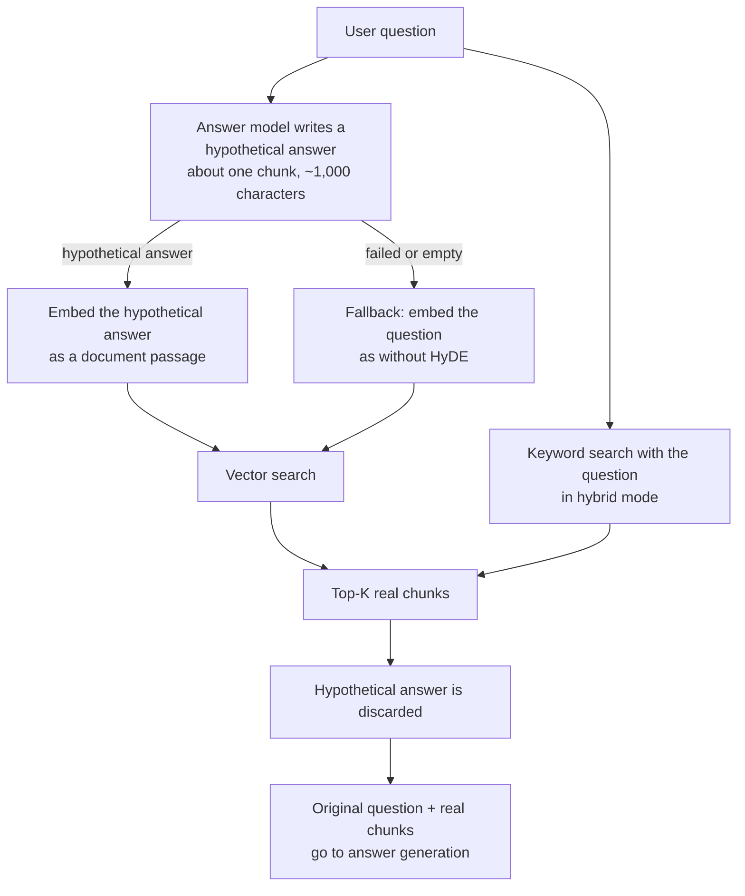
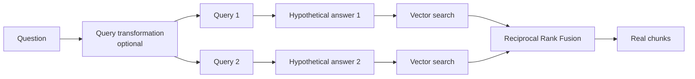

# HyDE (hypothetical answer embeddings)

HyDE, short for *Hypothetical Document Embeddings*, improves semantic search for short or vaguely
worded questions. A question such as *“how do I back up?”* looks very different from the
documentation passage that answers it. A **written answer** to that question looks much more like
that passage. So instead of embedding the question, ContextCrate lets the answer model write a
short hypothetical answer, embeds **that**, and uses it to find the real chunks.

HyDE is switched on **per crate** (default: off) on the crate's **Settings** page, section
**HyDE**, or with `hydeEnabled` in the [REST API](../api.md). It works at query time only, so
switching it on or off never rebuilds the index.

## How it works

1. The user's **question** is taken as usual.
2. The answer model writes a **hypothetical answer** of about one default chunk (1,000 characters).
3. That text, **not the question**, is embedded.
4. The **vector index** is searched with this embedding.
5. The top-K **real chunks** are retrieved.
6. The hypothetical answer is **discarded**. It is never stored, logged, audited or returned.
7. The real chunks and the **original question** are used for [grading](grading.md),
   answer generation and [verification](answer-verification.md).

The hypothetical answer is a search aid, not a source. It may contain wrong or invented details,
because only its *shape and vocabulary* are used to find real documents. The answer model that
writes the final answer never sees it, so a wrong guess cannot leak into the answer.

## What changes in the search

| Part of the search | Uses |
|---|---|
| Vector (semantic) leg | The embedded **hypothetical answer** |
| Keyword (lexical) leg in hybrid mode | The real **question** |
| Reranking | The real **question** |
| Snippets and highlighting | The real **question** |
| Grading, answer generation, verification | The real **question** and the real chunks |

The hypothetical answer is embedded as a *document passage*, not as a *query*. Embedding models
that distinguish the two (for example with `query:` and `passage:` prefixes) therefore treat it
like the indexed chunks, which is what HyDE relies on.

Retrieval modes:

- **Hybrid:** the vector leg uses HyDE; the keyword leg keeps the question, so exact terms such as
  error codes and identifiers still match.
- **Semantic:** the whole search is the HyDE vector search.
- **Lexical:** HyDE is skipped, because there are no vectors to search. No model call is made and
  the skip is counted (`reason="lexical-mode"`).

## Combining with query transformation

HyDE and [query transformation](query-transformation.md) are independent and can be combined. When
both are on, the transformation first produces the queries (up to six); HyDE then writes **one
hypothetical answer per query**, and every query is searched with its own. The ranked lists are
merged with Reciprocal Rank Fusion as usual.

Each searched query adds one model call, so use the two together only when both are worth their
cost. A good pairing is *sub-queries* for multi-part questions with HyDE for vague wording. For
most crates, one of the two is enough.

## Failure behavior

HyDE is fail-open. An answer is never blocked because of it.

| Situation | What happens |
|---|---|
| The model call fails or times out | The question is embedded as usual. Counted as `failed`. |
| The model returns an empty reply | Same. Counted as `failed` (`reason="empty"`). |
| The reply is longer than 2,000 characters | It is cut at 2,000 characters. |
| Lexical retrieval mode | HyDE is skipped, no model call. |
| The answer model is not available | HyDE is skipped, the question is embedded. |
| Embeddings are not available | HyDE is skipped, no model call. Hybrid search falls back to keyword search as usual. |

## When to use it

HyDE helps when the question and the documents use different words or a different level of detail:

- Short, vague or conversational questions.
- Natural-language questions over technical documentation, policies and manuals.
- Domains where users do not know the official terms.

It helps less, or can hurt, when:

- The question already contains the exact terms to find (an error code, a class name, a config key).
  Hybrid mode keeps these working through the keyword leg, but the vector leg gains little.
- The crate is mostly source code. A hypothetical answer in prose does not look like code.
- The model knows little about the topic and writes a confidently wrong passage. The results then
  drift towards that guess. Check the effect on your own questions before enabling it.

## Cost, latency and privacy

- **One extra answer-model call per searched query**, before any search starts. The reply is about
  1,000 characters (roughly 250 to 350 tokens), and the call is not streamed. Expect a few hundred
  milliseconds to a few seconds of added latency, depending on the model.
- The embedding call is the same size as for a normal query, only longer text.
- The **question is sent to the configured answer provider**, like for grading and query
  transformation. The hypothetical answer is sent to the embedding provider. Use TLS and treat both
  providers as data processors.
- Neither the question nor the hypothetical answer is written to the audit log. The
  `ANSWER_GENERATED` entry only records `hyde=<n>`, the number of searches that used a
  hypothetical answer.
- The question is passed to the model as untrusted data, never as instructions.

## Configuration

| Where | Setting |
|---|---|
| Crate **Settings → HyDE** | The **Enabled** switch. Default: off. |
| REST API | `PUT /api/v1/crates/{crateId}/settings/rag` with `"hydeEnabled": true`. Omit the field to keep the current value. |
| Backup | `hydeEnabled` is part of the exported RAG settings. Older exports without it import as off. |

HyDE reuses the crate's OpenAI-compatible answer endpoint, model, credentials, headers and timeout,
and the crate's embedding provider. It needs both to be configured and enabled. The size of the
hypothetical answer follows the default chunk size and is not configurable.

## Observability

| Metric | Meaning |
|---|---|
| `contextcrate_answer_hyde_total{outcome,reason}` | Attempts by outcome: `ok`, `failed` (`error` or `empty`) or `skipped` (`lexical-mode`, `embeddings-unavailable` or `answer-model-unavailable`). |
| `contextcrate_answer_hyde_duration_seconds` | Time of one hypothetical-answer generation. |
| `contextcrate_answer_hyde_length` | Length of the generated text in characters. A value far below 1,000 means the model ignores the length hint. |
| `contextcrate_llm_requests_total` / `llm_duration_seconds` with `purpose="hyde"` | The model calls, next to `grade`, `answer`, `verify`, `revise` and `transform`. |

`contextcrate_answer_retrieval_duration_seconds` does **not** include the HyDE generation, so the
two never count the same time. The Grafana dashboard has a **HyDE** section with the call rate,
failure rate, average length, generation time and outcomes, and HyDE appears as its own band in
**Where the time goes**. To judge whether HyDE helps, compare the
[grading kept ratio](grading.md#observability) before and after enabling it: a higher ratio means
retrieval returns fewer irrelevant chunks.

## Troubleshooting

| Symptom | Likely cause | What to do |
|---|---|---|
| No change in results | HyDE is off, or the crate uses lexical mode | Check **Settings → HyDE** and the default retrieval mode |
| Many `failed` outcomes | The answer model is down, slow or returns empty replies | Check the answer model settings and `llm_requests_total{purpose="hyde"}` |
| Many `skipped` with `answer-model-unavailable` or `embeddings-unavailable` | No answer model or embedding provider is configured and enabled for the crate | Configure one under the provider settings |
| Answers got slower | The extra call runs before retrieval | Use a faster model, or turn HyDE off for latency-sensitive crates |
| Exact identifiers are found worse | The vector leg drifts to the guess | Keep hybrid mode, so the keyword leg still matches exact terms |
