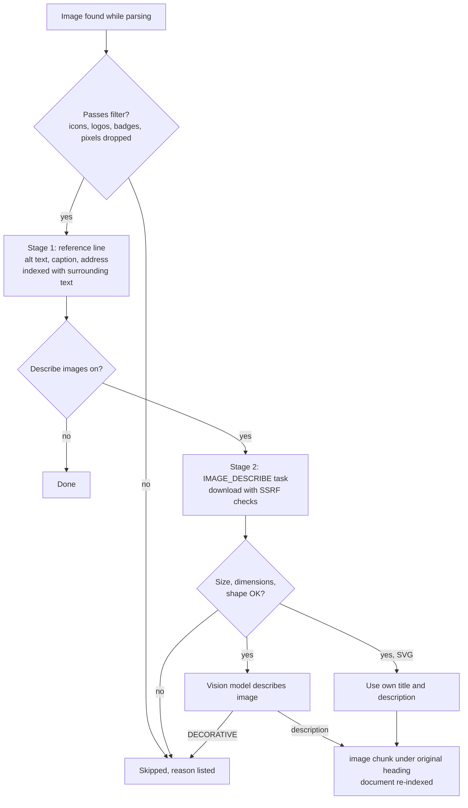

# Images

Images in documentation carry information that text search cannot see: architecture diagrams,
screenshots, charts. ContextCrate can make the **meaningful** ones searchable and citable, without
indexing every icon, logo and badge a page contains.

Image handling is configured per crate under **Settings → Images**, and can be switched off
completely.

## Settings

| Setting | Default | Meaning |
|---|---|---|
| **Index images** | on | Master switch. Off: images are ignored everywhere, including image files in Git. |
| **Describe images with a vision model** | off | Downloads each image that passes the filter and has a vision model describe it. |
| Vision model | the crate's answer model | A shared answer model chosen by an administrator, or the crate's own answer model. It must accept images. |
| **Send images to the answer model** | on | Attaches the picture of a retrieved image source to the answer request (see below). Applies to answers at once. |
| **Show images in the answer** | on | Lets the answer model place a picture of a source in its answer, returned to the client as a base64 Markdown image (see below). |
| Maximum images described per run | 200 | Upper bound on vision calls (and cost) per ingestion run. |
| Maximum bytes per image | 5 MiB | Larger images are skipped. |
| Smallest image | 64 px | Images declared smaller than this in width or height are skipped. |
| Extra skip patterns | empty | Comma-separated. An image whose address, class or alt text contains one is skipped. |

The same fields are available through `PUT /api/v1/crates/{crateId}/settings/rag`:
`imageIndexingEnabled`, `imageDescriptionEnabled`, `imageVisionModelId`, `imageMaxPerRun`,
`imageMaxBytes`, `imageMinSize`, `imageSkipPatterns`, and `sendImagesToModel` and `includeImagesInAnswer` for the answer options. Omitted fields keep their value.

Changes apply to the next ingestion run. Switching image handling off does not remove image
entries that are already indexed; they disappear when the documents are ingested again.

An administrator can forbid vision descriptions for the whole installation under
**Policies → Model policy** (see [Administration](../operations/administration.md#model-policy)).
With that switch off, **Describe images** cannot be turned on.

## Two stages

### 1. Image references (no downloads)

For every image that passes the filter, the parser adds a line to the text, next to the
surrounding paragraph:

```text
[Image: Architecture of the ingestion pipeline — Figure 1] (https://docs.example.com/img/arch.png)
```

The label is the alt text, else the title, else the file name. A caption (`<figcaption>`) is
included. This line is chunked and indexed with the text around it, so a question about the
architecture finds the paragraph and the image reference together, and the answer can cite the
image address. Nothing is downloaded and no model is involved.

### 2. Descriptions (opt-in)

With **Describe images** on, every image that passed the filter is queued as an `IMAGE_DESCRIBE`
task:

1. The image is downloaded (web) or read from the checkout (Git). Downloads follow the same
   safety rules as crawling: private and metadata addresses are blocked, redirects are checked at
   every hop, the size is limited. Pages that need a login do not expose their images this way.
2. Post-download checks skip images under 5 KB, with a shorter side under 128 px, or banner-shaped
   (longer than eight times the shorter side). SVG files are not sent to a model; their own title
   and description are used.
3. A vision model gets the image and is asked to describe it, transcribe visible text and list the
   components of diagrams. If it answers `DECORATIVE`, the image is skipped.
4. The description is added to the document as an `image` chunk under the heading where the image
   appeared, with the image address, and the document is re-indexed.

Identical images (same content) in a crate are described once and the description is reused.
A failure only marks that image as failed; the run and the document are not affected.



## What is skipped

Images are filtered before anything is downloaded. Skipped images are listed with the reason on
the document's **Images** section.

| Rule | Examples |
|---|---|
| Marked decorative | `alt=""`, `role="presentation"`, `aria-hidden="true"` |
| Too small | declared width or height under the smallest-image setting |
| Name hints | `icon`, `logo`, `avatar`, `emoji`, `badge`, `sprite`, `spinner`, `favicon`, `social`, `share`, `button`, `arrow`, `pixel`, `tracking` as a word in the address, class, id or alt text (`company-logo.png` matches, `silicon.png` does not) |
| Badges and trackers | `img.shields.io`, `badgen.net`, gravatar, analytics and ad pixels |
| Other | `.ico` files, tiny inline `data:` images, SVG sprite references, duplicates on the page |
| Per-page limit | the first 20 images that pass |

A real caption, or an alt text of four or more words, outranks a name hint: a diagram called
`logo-architecture.png` with the alt text "Architecture of the ingestion pipeline" is kept.

Navigation, header and footer images are already gone when the job removes `nav, footer, aside`
(the default **Remove selectors**).

## Where images are found

| Source | What is read |
|---|---|
| Web pages | `img` (the largest `srcset` entry, or `data-src`), `picture`, `figure` with `figcaption`, an image wrapped in a link to a larger image, and inline `svg` with a `title` or `desc` |
| Markdown | ``. Relative paths are resolved against the file and turned into a link to the file on GitHub, GitLab or Forgejo. |
| Git image files | `.png`, `.jpg`, `.gif`, `.webp`, `.svg` that match the source's include and exclude globs. Each becomes a small document searchable by its file name and path; with descriptions on, also by its content. |

Images referenced from Markdown in a repository are not downloaded for descriptions, because the
checkout is gone after the run. Describe them by letting the image file itself be imported
(include `docs/img/**` for example).

## Choosing a configuration

| Goal | Settings |
|---|---|
| Cheapest option, answers can still link to figures | Image indexing on, descriptions off (default) |
| Questions about diagrams and screenshots should be answerable | Image indexing and **Describe images** on, with a vision-capable model |
| No image content may leave the installation | Descriptions off, or use a vision model hosted inside your network |
| Documentation with many decorative graphics | Keep the filter on; check the skipped list and the `kept`/`skipped` metrics |

## Troubleshooting

| Symptom | Likely cause | What to do |
|---|---|---|
| Descriptions never appear | Descriptions are off, an administrator forbade them, or no vision-capable model is configured | Check **Settings → Images** and the model policy |
| An important figure is missing | The filter judged it an icon, logo or tracking pixel by size or name | Inspect the skipped list for its reason |
| Images from a repository are not described | The checkout is gone after the run, so referenced images cannot be fetched | Import the image files themselves, for example include `docs/img/**` |
| Many `failed` description outcomes | The model rejects images, the format is unsupported, or the endpoint times out | Check the model, and the `contextcrate_images_descriptions_total` metric |
| Images behind a login are not described | Pages that need a login do not expose their images to the download | Make the images publicly reachable or import them from the repository |

## Sending images to the answer model

A description makes an image findable, but it can miss details. With **Send images to the answer model** (on by
default, in the Images section of the crate settings) the answer model also gets the picture itself. When a retrieved
source is an image, ContextCrate adds the image to the request in the multimodal format of the OpenAI chat
completions API: the message with the sources becomes a list of parts, a `text` part with the sources followed by
`image_url` parts whose URL is a `data:image/png;base64,...` string, each preceded by a short text naming the source
(`Image belonging to [SOURCE 2]:`). Messages without a picture are unchanged plain strings.

- **Which images:** the images of the sources the answer is built from, only those that were described, in source order.
  At most **4** per answer and about 12 MB in total; each image is limited by *Maximum bytes per image*. Only
  png, jpeg, gif and webp are sent. An image that cannot be read is left out, the answer is generated anyway.
- **Where the bytes come from:** images that are described from now on are kept in the artifact store, so answering does not
  download them again. Images described earlier are downloaded when needed, with the same address checks as crawling.
- **Verification:** if answer verification is on, the verifier sees the same pictures, so statements that come from a
  picture are not flagged as unsupported. Grading, HyDE, compression, query transformation and enrichment stay text-only.
- **Models without vision:** the answer model must accept images. If it answers the request with an error, ContextCrate
  asks again without the pictures (when nothing had been streamed yet), writes a warning to the log and counts
  `answer.images{outcome="fallback"}`. So the default does not break a text-only model, but every answer then costs
  a second request: switch the option off for such a crate.
- **Cost and privacy:** pictures use tokens, and they are sent to the answer model endpoint, not only the description.

## Returning images to the user

Seeing a picture is not enough when the user asks "show me the Grafana dashboard": the answer model can describe the
picture, but the user would never see it. With **Show images in the answer** (on by default; needs *Send images to the
answer model*) the model is told which pictures it was given and may place one where it helps:

1. The model writes `[[image:n]]` on its own line, `n` being the number of the source the picture belongs to. It is told
   to use a marker only for a picture it was given and at most once per picture.
2. ContextCrate replaces the marker by a Markdown image with the picture inline:
   ``. A marker for a picture that was not given, or a second marker for the
   same picture, is removed.
3. The OpenAI-compatible chat completions API (`message.content`, streamed and not streamed) and the answers API (`delta` event)
   return that text. Chat UIs that render Markdown, such as Open WebUI or LibreChat, show the picture; a client that does not
   render `data:` URLs shows the Markdown text. Citations are added before the picture is embedded, so footnotes are not affected.
4. Everything else sees the answer **without** markers and picture data: answer verification, evaluation (stored answers
   and scores), the audit log, and the MCP tool answer.

The model decides when a picture helps; it is not appended to every answer. If the model did not receive pictures (no image
source was retrieved, the option is off, or the model rejected images and ContextCrate answered again without them), no
picture is returned. A picture can add several MB to a response, at most 4 per answer.

## Privacy and security

- With **Describe images** on, image content is sent to the configured model endpoint. It is off
  by default, and an administrator can forbid it.
- With **Send images to the answer model** (default on) the pictures of retrieved image sources are sent to the answer model endpoint as base64. Switch it off for crates whose images must not leave the system through the answer endpoint.
- A description is retrieved content like any other: it is treated as untrusted when it is given
  to the answer model, because an image can contain text that tries to give instructions.
- API keys of shared models are never shown to crate owners.

## Metrics

`contextcrate_images_total{result="kept|skipped"}` counts filter decisions and
`contextcrate_images_descriptions_total{outcome="described|skipped|failed"}` the vision results. `contextcrate_answer_images_total{outcome="sent|skipped|fallback"}` counts answers that carried pictures, pictures that were left out, and answers repeated without pictures.
