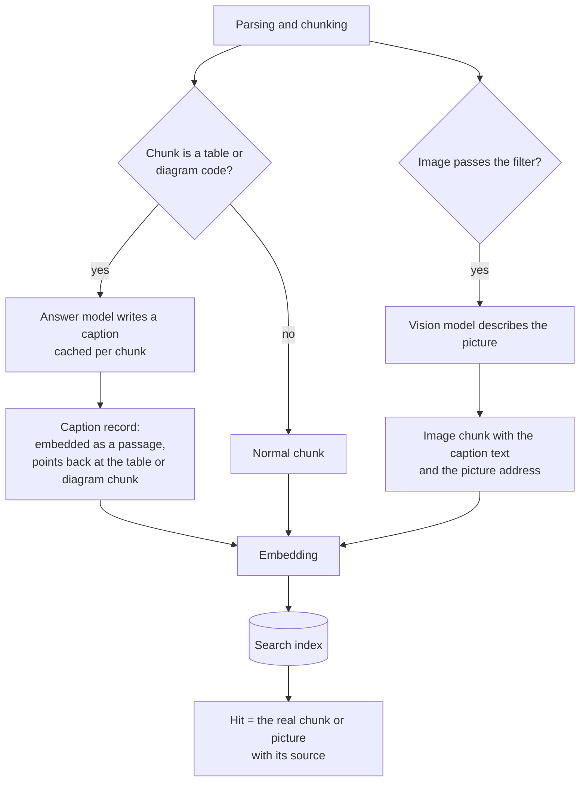

# Captions and multi-modal RAG

Documentation is not only prose. Pricing tables, comparison matrices, architecture diagrams and
screenshots carry facts that a text question rarely matches: a table is mostly numbers and short cell
values, and a picture has no words at all. ContextCrate therefore writes a **caption** for each of them
**before indexing**: a short description in plain words. The caption is embedded and indexed, so the
question *"which plan is cheapest?"* finds the pricing table, and *"how does the crawler reach the
index?"* finds the diagram, even though neither contains these words.

## The three kinds of captions

| Kind | What gets a caption | Written by | Setting |
|---|---|---|---|
| **Image** | A picture that passes the [image filter](images.md#what-is-skipped): screenshot, chart, diagram image | A **vision-capable model** (it sees the picture) | **Settings → Images → Describe images** |
| **Table** | A table in a web page or Markdown file | The crate's **answer model** (it reads the table text) | **Settings → Captions** |
| **Diagram code** | A fenced block in Mermaid, PlantUML (`plantuml`, `puml`) or Graphviz (`dot`, `graphviz`) | The crate's **answer model** (it reads the diagram source) | **Settings → Captions** |

All three are **off by default**, are switched on per crate, and are fail-open: a chunk or picture without
a caption is still indexed and searchable.

A table is already text, so it does not need a vision model; the answer model can describe it from its
rows. A diagram given as code is text as well. A diagram that is a **picture** is an image caption.

## How it works

1. **Parse and chunk.** Tables and diagram code stay in one piece as chunks, like any other block.
2. **Caption.** For every table chunk and diagram-code chunk, the answer model gets the text (up to 6,000
   characters) and writes two to four sentences: what the table compares and its main values, or what the
   diagram shows, its components and how they connect. For every kept image, the vision model describes the
   picture, transcribes visible text and lists the components of diagrams.
3. **Embed.** The caption is embedded as a **passage**, exactly like a chunk. The original chunk is embedded
   too, so a question that uses the table's own words still finds it.
4. **Search.** Keyword and vector search run over chunks and captions together. When a caption matches,
   the hit is the **chunk it belongs to**, once, even if both the caption and the chunk matched.
5. **Answer.** The answer model receives the **real table or diagram** (and, for images, the description and
   optionally the picture), never only the caption. A caption is a way to *find* the chunk, not a source.

## Metadata: which source does a caption belong to?

Every caption points at its chunk, so a hit carries the full source information of the chunk:

| Metadata | Table and diagram captions | Image captions |
|---|---|---|
| Document and **source URL** | from the chunk's document | from the document the image appeared in |
| Title | document title | document title |
| **Heading** (section path) | the chunk's heading path | the heading where the image appeared |
| **Position** | the ordinal of the chunk | the ordinal of the image chunk, and the **anchor**: the ordinal of the text chunk that contains the image |
| Kind of caption | `table` or `diagram` (stored with the cached caption) | chunk kind `image` |
| Picture address | none | `media_url` of the image (and a link to the file for Git sources) |
| Record type in the index | `caption` | `chunk` |

Because the caption record names its chunk, citations, [grading](grading.md), the
[context window](context-window.md) and [hierarchical retrieval](hierarchical-retrieval.md) all work on
the real chunk. A table caption never appears as a source of its own.

## Settings

| Where | Setting |
|---|---|
| **Settings → Captions** | **Enabled**: captions for tables and diagram code. Default off. |
| **Settings → Images** | **Index images**, **Describe images with a vision model**, vision model and limits; see [Images](images.md). |
| REST API | `PUT /api/v1/crates/{crateId}/settings/rag` with `captionsEnabled` (tables and diagrams) and the `image…` fields. Omitted fields keep their value. |
| Backup | `captionsEnabled` is part of the exported RAG settings. Older exports import as off. |

Switching **Captions** on or off rebuilds the index in the background. So does changing the answer model
or the embedding model while it is on. Captions of unchanged chunks are reused, so only new or changed
tables and diagrams call the model. Image descriptions are created during ingestion as described in
[Images](images.md).

## Failure behavior

| Situation | What happens |
|---|---|
| The model fails, times out or returns nothing usable | The chunk is indexed without caption. Nothing is cached, and the next rebuild tries again. Counted as `failed`. |
| The answer model is not available | Same; no model call is made. |
| The chunk is not a table or diagram code | It is skipped, no model call. |
| The vision model answers `DECORATIVE` for a picture | The picture is skipped. |
| Captions are switched off | No captions are created. Existing caption records leave the index with the next rebuild. |

## Cost and privacy

- **One answer-model call per table or diagram**, with at most 6,000 characters of that chunk. Four calls run
  in parallel while indexing. Captions are cached by a fingerprint of the chunk text, heading, kind, model
  and prompt version.
- **One vision-model call per distinct image** (identical images are described once).
- Each caption adds **one more embedding** and one more entry to the index.
- The text of tables and diagrams is sent to the **answer provider** while indexing; picture content is
  sent to the **vision model endpoint**. Treat both as data processors. An administrator can forbid vision
  descriptions for the whole installation.
- A caption is generated content from untrusted documents, so it is only used for searching; text inside a
  document cannot give instructions to the model that writes the caption (the prompt marks it as data).

## Limits

- **SVG** pictures are not sent to the vision model (inline SVG and SVG files use their own title and
  description). Diagrams drawn as raster images (PNG, JPEG, WebP, GIF) are captioned.
- Diagrams are captioned when they are **code** in one of the languages above or a **picture**. Other
  diagram notations are indexed as code.
- Images that a **Markdown or Git** source references are not downloaded for captions, because the checkout
  is gone after the run; import the image files themselves (see [Images](images.md#where-images-are-found)).
- A table is detected as two or more consecutive rows with cells separated by ` | `, which is how both
  parsers write tables. A table with a single column is not captioned.
- The caption chunk of a described **image** is stored after the text of its document, but remembers where its
  image sits (the text chunk that contains the image reference, or, if that cannot be found, the last text
  chunk under the heading of the image). Images described before this was recorded have no position and
  behave as before; they get one when the document is ingested again.

## Observability

| Metric | Meaning |
|---|---|
| `contextcrate_ingestion_captions_total{kind,outcome}` | Table and diagram captions by outcome: `generated`, `cached` or `failed` |
| `contextcrate_ingestion_captions_duration_seconds` | Time to caption the tables and diagrams of one document |
| `contextcrate_llm_requests_total{purpose="caption"}` | The answer-model calls for captions |
| `contextcrate_images_descriptions_total{outcome}` | Vision results for images; see [Images](images.md#metrics) |

## Troubleshooting

| Symptom | Likely cause | What to do |
|---|---|---|
| A table is found by its own words but not by a plain question | Captions are off, or its caption failed | Switch **Captions** on, check `ingestion_captions_total` for `failed` |
| No table is ever captioned | The table has one column, or no ` | ` rows (for example a layout table with one cell per row) | Check the chunk text of the document |
| Many `failed` outcomes | The answer model is down or returns an unexpected format | Check the answer model settings and the log for `Caption generation failed` |
| A picture is not captioned | Image descriptions are off, the image was filtered, or it is an SVG | See [Images](images.md#what-is-skipped) |
| Answers got slower to index | One model call per table and diagram | Use a faster model, or leave captions off for crates with many tables |
