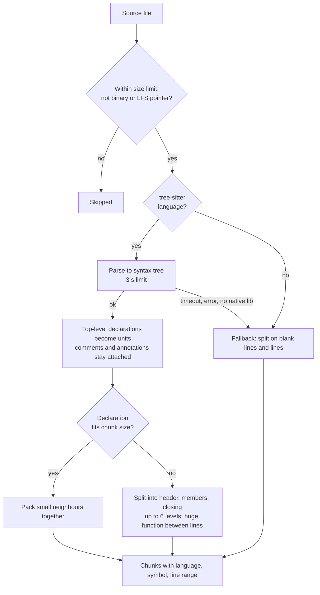

# Parsing

Parsing turns what a source delivers (a web page, a Markdown file, a source file) into a clean
document and a list of structural **blocks**. [Chunking](chunking.md) then packs the blocks into
the chunks that are indexed. Parsing is where structure is either kept or lost, so ContextCrate
parses each content type with a parser that understands it.

| Content | Parser | Result |
|---|---|---|
| Web pages (HTML) | jsoup, walked as a document tree | Blocks with heading path; code, tables and lists kept intact |
| Markdown | CommonMark parser | Blocks with heading path; fenced and indented code with language |
| Source code | tree-sitter syntax tree | One block per function, class or method with its symbol |
| Plain text | Paragraph splitting | Prose blocks |

Parsing runs after a file has been fetched and stored, as the `PARSE` pipeline stage (see
[Pipeline](../pipeline.md)). If a document's text is identical to its current version, parsing stops
and nothing is re-indexed.

## What every parser produces

- **Title.** Page title, first heading, or the file name.
- **Body.** The normalised text of the document, with code still inside fences. The body is
  stored with the document and is used for change detection.
- **Blocks.** Ordered units, each tagged as prose or code, with language where known and the
  headings above it.
- **Metadata.** Headings, the detected format and language, and for Git sources the path, ref and
  resolved commit.

All text is normalised to Unicode NFC. Line endings are converted to `\n`.

## Web pages (HTML)

1. **Cleaning.** Elements matching the job's **Remove selectors** are dropped. The default is
   `script, style, nav, footer, aside`.
2. **Main content.** The **Content selector** is used if set. Otherwise the first `main`,
   `article` or `[role=main]` element, and `body` as a last resort.
3. **Rendering fallback.** If a page has almost no text but many scripts, ContextCrate
   re-fetches it in a headless browser once and parses the rendered result.
4. **Structure.** The tree is walked in document order:

| HTML | Becomes |
|---|---|
| `h1` to `h6` | Section boundary; the heading path for everything below |
| `pre` (with or without `code`) | A **code block**. Line breaks and indentation are kept exactly. |
| `table` | One block of `cell | cell` rows, kept together |
| `ul`, `ol` | One block of `- item` lines, nested lists indented |
| `p`, `blockquote`, other text | Prose blocks with whitespace collapsed |
| `img`, `picture`, `figure`/`figcaption`, inline `svg` | An **image reference** (alt text, caption and address) when image indexing is on; see [Images](images.md) |

Inline `code` inside a sentence stays part of that sentence.

### Code block language

The language of a code block is read from the class names of the `pre`, its inner `code` and its
wrapper, for example `language-python`, `lang-sql`, `highlight-source-go`, `brush: java`, or from a
`data-lang` attribute. Documentation generators such as Docusaurus, MkDocs, Sphinx, GitHub and
Hugo all use one of these. When none is found the block is still kept as code, without a language.

### Links

Links on a page are used to discover further pages, within the scope configured on the job
(depth, page limit, allowed host, include and exclude patterns).

## Markdown

Markdown is parsed with a CommonMark parser, not with regular expressions, so the structure is
what the document actually means:

- **Fenced code blocks** keep their exact text and their language from the info string
  (` ```python `). The closing fence must match the opening fence, as in the specification.
- **Indented code blocks** are recognised and keep their indentation.
- **Inline code** is kept verbatim, including `snake_case`, `__init__`, `*args` and
  `List<String>`. Earlier versions removed these characters.
- **Headings** at any level, including underlined headings, form the heading path. Headings inside
  code blocks are not headings.
- **Tables** (GitHub style), **lists** (nested, ordered and unordered) and **block quotes** are
  kept as single blocks.
- Emphasis markers, link syntax and HTML tags are removed from prose; the link text is kept.
- **Images** (``) become image references when image indexing is on. Relative paths are
  resolved against the file and linked to the file on the forge. See [Images](images.md).

Files with the extension `.md` or `.markdown` are parsed as Markdown.

## Source code

Source files from Git are parsed with [tree-sitter](https://tree-sitter.github.io), which builds a
real syntax tree. Chunks follow that tree instead of character counts.

### Supported languages

| Syntax-aware (tree-sitter) | Extensions |
|---|---|
| Java | `.java` |
| Python | `.py`, `.pyw` |
| JavaScript | `.js`, `.mjs`, `.cjs`, `.jsx` |
| TypeScript | `.ts`, `.mts`, `.cts` |
| Go | `.go` |
| Rust | `.rs` |
| C | `.c`, `.h` |
| C++ | `.cc`, `.cpp`, `.cxx`, `.hpp`, `.hh`, `.hxx` |
| C# | `.cs` |
| Ruby | `.rb` |
| Shell | `.sh`, `.bash`, `.zsh` |

Other well-known file types are **labelled with their language** and split on blank lines and
lines: Kotlin, PHP, Swift, Scala, SQL, YAML, JSON, TOML, XML, HTML, CSS, SCSS, Groovy/Gradle,
Lua, Perl, R, Dart, Terraform, Protobuf, INI, properties, reStructuredText, AsciiDoc, Dockerfile
and Makefile. Any other file that is text is treated as plain text.

### How code is cut

1. The file is parsed into a syntax tree.
2. Every top-level declaration (class, function, method, module, impl block, …) becomes a unit.
3. A comment, docstring or annotation directly above a declaration is kept **with** that
   declaration.
4. A declaration that fits into the chunk size stays whole. A larger one, typically a big class,
   is split into a header, its members, and its closing lines. Members are split recursively, up
   to six levels deep.
5. Small neighbouring units, such as imports and short functions, are packed into one chunk until
   the chunk size is reached.
6. A single function larger than the chunk size is cut between lines, never inside a line.

Every chunk records the programming language, the **qualified symbol** (`UserService.findById`,
`Box.open`), and the first and last line. The line range makes it possible to link back to the
exact place in the repository.



### Example

For a small Java file:

```java
package demo;

import java.util.List;

/** Looks up users. */
public class UserService {
  public User findById(long id) { ... }
  public List<User> findAll() { ... }
}
```

the parser sees these units. A file this small fits into a single chunk, so they are packed together.
In a larger file each declaration that ends up in its own chunk carries the metadata shown:

| Unit | Symbol | Notes |
|---|---|---|
| Package and imports | (file) | Small neighbours, packed together |
| Class header with its Javadoc | `UserService` | The comment stays with the class |
| `findById` | `UserService.findById` | Only separate from its siblings when the class is larger than the chunk size |
| `findAll` | `UserService.findAll` | As above |

A search for `UserService.findById`, `findById` or just `find by id` can find it, because the
symbol and language are part of the indexed text. See [Chunking](chunking.md#chunk-metadata).

### Safety and fallback

Source files come from repositories ContextCrate does not control, so parsing is defensive:

- Parsing has a time limit of three seconds per file.
- Files above the job's **Maximum bytes per file** (default 1 MiB) are skipped, as are binary files
  and Git LFS pointers.
- If a file cannot be parsed, or the tree-sitter native library cannot be loaded on the platform,
  the file is split on blank lines and lines instead. Indexing continues and a warning is logged
  once. A file with syntax errors still gets as much structure as the parser could recover.

The tree-sitter library is a prebuilt native component that depends only on the C library. Its
language grammars are versioned in the application, so a new language needs a new ContextCrate
release.

## Images

Image handling is a separate, optional layer on top of parsing and can be switched off per crate
under **Settings → Images**. When it is on, the parsers above recognise images, drop icons, logos,
badges and tracking pixels, and keep a one-line reference with the alt text, caption and address
in the text. Optionally a vision model describes the remaining images. All rules, defaults and
the privacy implications are described on the [Images](images.md) page.

## Plain text

Files with the extension `.txt`, and unknown text files, are split into paragraphs at blank lines.
Paragraphs are then packed into chunks like any other prose.

## Choosing which Git files are imported

By default **every text file** of the repository is imported. Control this per source in the
ingestion job under **Include globs** (whitelist) and **Exclude globs** (blacklist).

| Pattern | Matches |
|---|---|
| `**` | Everything (the default for include) |
| `*.java` | Java files in any directory |
| `docs/**` | Everything below the top-level `docs` directory |
| `src/**/*.py` | Python files anywhere below `src` |
| `node_modules/` | The whole directory, wherever it is |
| `package-lock.json` | That file name in any directory |
| `**/generated/**` | Any `generated` directory, at any depth |

A file is imported when it matches at least one include pattern and no exclude pattern. Several
patterns are separated by commas. The matching rules follow `.gitignore` conventions: a pattern
without a slash matches in any directory, a trailing slash selects a directory.

Typical setups:

- **Documentation only:** include `docs/**, *.md`.
- **A Java service:** include `src/**, *.md`, exclude `**/generated/**, *.min.js`.
- **Everything except noise:** keep `**` and exclude `node_modules/, dist/, build/, *.lock, package-lock.json`.

Image files (`.png`, `.jpg`, `.gif`, `.webp`, `.svg`) follow the same patterns. They are imported
as small image documents while **Index images** is on in the crate settings, and skipped as binary
files otherwise. Icons, logos and similar are filtered by name, see [Images](images.md).

Regardless of the patterns, ContextCrate skips the `.git` directory, symbolic links, other binary files,
Git LFS pointers, empty files, files larger than **Maximum bytes per file**, and anything beyond
**Maximum files** (default 10,000).

## Upgrading

Parsing, chunking and the keyword index tokenisation changed in this version. After upgrading,
run each ingestion job once more: documents are re-parsed and get a new version where their text
or structure changed. Existing index entries keep the old tokenisation (no identifier splitting)
until their documents are indexed again, which happens when a job creates a new version of the
document or when the index is rebuilt.


## Troubleshooting

| Symptom | Cause | What to do |
|---|---|---|
| A file is missing from the crate | It does not match an include glob, matches an exclude glob, is larger than **Maximum bytes per file**, is binary, or is a Git LFS pointer | Check the globs and the size limit. Files skipped for size or content are skipped silently |
| A file fails to import with an error | A single unreadable file or one the artifact store rejects does not stop the import. It is skipped, the rest of the repository continues | Look for `Skipping git file` in the logs to see which ones |
| Code is split on blank lines and has no symbol | The language is not tree-sitter supported, or parsing hit the three second limit, or the native library is unavailable | Check the supported-language table and the startup log for the tree-sitter warning |
| Web page text contains navigation or cookie banners | The page layout puts them in the main content | Narrow the crawl to a content path, or exclude those pages |
