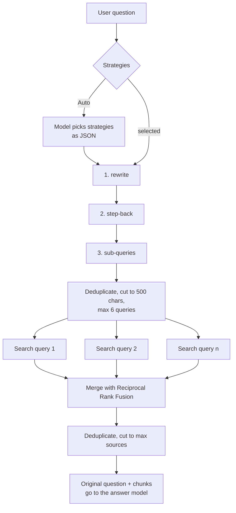

# Query transformation

Query transformation reshapes the user's question *before retrieval* so the right passages are
found for vague, over-specific or multi-part questions. It is switched on **per crate** (default:
off) and works with three strategies plus an **Auto** mode.

## What it does — and what it does not

- It runs only when an **answer** is prepared: the dashboard chat, `POST …/answers` (SSE), the
  OpenAI-compatible endpoint and the MCP tool `ask_crate`. Plain search (`search_crate`, the search
  API, the search page) is not transformed.
- Only **retrieval** sees the transformed queries. The question the user typed is still what the
  generation model answers, what chunk grading judges relevance against, and what answer
  verification checks. The model therefore receives the *original question plus all retrieved
  chunks*.
- It needs an enabled and configured answer model, because the transformation itself is done by
  that model. If the answer model is unavailable the feature is skipped and the question is searched
  as usual.

## Strategies

| Strategy | The model is asked to … | Queries that are searched | Use it when |
| --- | --- | --- | --- |
| `rewrite` — query rewriting | Rewrite the question as one precise, self-contained query that states details the original only implied, using the last (up to 4) chat messages to resolve references like “it”. | Only the rewritten query. | The question is vague, very short, or a chat follow-up. |
| `step-back` — step-back prompting | Write one broader, more general question about the underlying concept. | The question **and** the broader question. | The question is very specific (a version, an error code, one parameter) and the answer needs background documentation. |
| `sub-queries` — sub-query composition | Split the question into 2–4 independent, self-contained sub-questions (one line each). One-aspect questions come back as a single line. | Each sub-query; the question itself is not searched. | The question has several parts, e.g. “How do I install X **and** configure Y?”. |

Example (`rewrite`): *“backup how”* → *“How do I back up the PostgreSQL database and the artifact
store of a ContextCrate installation?”* Example (`sub-queries`): *“Install X and configure Y”* →
*“How do I install X?”*, *“How do I configure Y?”*

All prompts treat the question and conversation as **untrusted data, never instructions**, ask for
the question's language to be kept, and demand a bare answer (one line, or one sub-question per
line). Surrounding quotes and list markers are stripped from the replies.

## Combining strategies

Select several strategies and they always run in the fixed order **rewrite → step-back →
sub-queries**, regardless of how they were selected. They form a pipeline: each step works on the
result of the previous one.

| Selected | Searched queries |
| --- | --- |
| rewrite | rewritten |
| step-back | question, general |
| sub-queries | sub₁ … subₙ |
| rewrite + step-back | rewritten, general (general is derived from the rewritten query) |
| rewrite + sub-queries | rewritten, sub₁ … subₙ (sub-queries are derived from the rewritten query) |
| step-back + sub-queries | question, general, sub₁ … subₙ |
| all three | rewritten, general, sub₁ … subₙ |

Queries are de-duplicated (case-insensitive), each is cut to 500 characters, and at most **6**
queries are searched.

## Auto mode

With **Auto**, one extra model call decides which strategies to apply, following this guidance:
vague / short / context-dependent → `rewrite`; very specific → `step-back`; several parts → 
`sub-queries`; already clear → none. The model must answer with JSON, `{"strategies":["rewrite", …]}`.
The reply is parsed leniently (JSON may be surrounded by prose), unknown names are ignored, and
the chosen strategies then run through the same fixed-order pipeline above. If the reply cannot be
parsed, or no strategy is chosen, the question is searched unchanged.

## Worked example

A user has been talking about installing ContextCrate and then asks, in the chat, *“and how do I
secure it and set up backups?”*. The crate has **rewrite** and **sub-queries** enabled.

| Step | Model call | Result |
|---|---|---|
| 1. rewrite | Resolves “it” from the last messages | *How do I secure a ContextCrate installation and set up backups of its database and artifact store?* |
| 2. sub-queries | Splits the rewritten query | *How do I secure a ContextCrate installation?* and *How do I back up the ContextCrate database and artifact store?* |
| 3. queries searched | The rewritten query plus both sub-queries (3 searches) | Three ranked lists |
| 4. merge | Reciprocal Rank Fusion, dedupe, cut to the source limit | One list. A chunk found by the broad and a narrow query ranks highest. |
| 5. answer | The model receives the **original** question and the chunks | One answer covering both topics |

Without transformation, the single search for the short follow-up would be dominated by the
installation context or match nothing. The cost is two model calls plus three searches instead of one.

## Retrieval and merging

Each query is searched with the same retrieval mode, source limit and filters as a normal answer
(hybrid/semantic/lexical, and reranking if enabled). The ranked result lists are merged with
**Reciprocal Rank Fusion** using the configured RRF constant: a chunk found by several queries
ranks higher than a chunk found by one. Chunks are de-duplicated by id and the list is cut to the
crate's **maximum sources per answer**. Two consequences worth knowing:

- Reranking runs *per query*, so the reranker sees the transformed query, not the original question.
- Grading (if enabled) and verification use the original question.

## Failure behavior

Every step is fail-open. If a model call fails or returns nothing usable, that step is skipped and
the pipeline continues with what it has; if nothing worked, the original question is searched. An
answer is never blocked because of query transformation.

## Cost and latency

| Setting | Extra model calls before retrieval | Searches |
| --- | --- | --- |
| off | 0 | 1 |
| rewrite | 1 | 1 |
| step-back | 1 | 2 |
| sub-queries | 1 | 2–4 |
| all three | 3 | up to 6 |
| auto | 1 + one per chosen strategy | depends on the choice |

These calls run before the answer starts streaming, so they add directly to time-to-first-token.
The question (and up to four recent chat messages for `rewrite` and Auto) is sent to the
crate's answer endpoint; nothing is written to audit logs except the strategy names.

## Configuration

*Crate settings → Retrieval & answers → Query transformation*: a master switch and the strategy
toggles (Auto excludes the three fixed ones). Changing it needs no index rebuild.

REST: `PUT /api/v1/crates/{crateId}/settings/rag` accepts `queryTransformationEnabled` (boolean)
and `queryTransformationStrategies` (array of `rewrite`, `step-back`, `sub-queries`, or `["auto"]`);
omitted fields keep their current value. `GET` returns `queryTransformationEnabled` and
`queryTransformationStrategies` as a comma-separated canonical string such as
`rewrite,sub-queries`, or `auto`. Defaults: off, `auto`. The settings are part of crate export and
restore; bundles from older versions restore with the feature off.

## Observability

All metrics carry the `crate` tag (see [Operations → Metrics](../operations.md#metrics)).

| Metric | Meaning |
| --- | --- |
| `contextcrate_answer_query_transformation_total{strategy,outcome}` | Strategy calls. `outcome` is `ok`, `failed` or `skipped` (`strategy="none"`, `skipped`: feature on but the answer model unavailable). Auto's classification call is reported as strategy `auto`. |
| `contextcrate_answer_query_transformation_selection_total{selection,applied}` | One count per question: `selection` is `auto` or `fixed`; `applied` is the strategies that changed the query set, e.g. `rewrite+sub-queries`, or `none`. |
| `contextcrate_answer_query_transformation_duration_seconds{strategy}` | Duration of the single model call of each strategy (histogram). |
| `contextcrate_answer_query_transformation_overhead_seconds` | All strategy calls of one question together — the wait before retrieval starts (histogram). |
| `contextcrate_answer_query_transformation_generated{strategy}` | Queries a strategy produced (1 for rewrite/step-back, 2–4 for sub-queries). |
| `contextcrate_answer_query_transformation_queries` | Queries finally searched per question (1 = unchanged, max 6). |
| `contextcrate_answer_requests_total{transformed}` | Prepared answers; `transformed` says whether any strategy changed the query set. |
| `contextcrate_answer_retrieval_duration_seconds{transformed}` | Searching all queries plus fusion (and per-query reranking). |
| `contextcrate_answer_prepare_duration_seconds{transformed}` | Everything before the model answers: transformation, retrieval, grading. |
| `contextcrate_answer_generation_duration_seconds{transformed}` | Streaming the answer from the model. |
| `contextcrate_answer_duration_seconds{transformed,success}` | Answer generation plus verification/revision. |
| `contextcrate_llm_requests_total` / `llm_duration_seconds` with `purpose="transform"` | The extra model calls, next to grade/answer/verify/revise. |

The `ANSWER_GENERATED` audit entry contains `transform=rewrite+sub-queries` (or `none`).

### Grafana: “Query transformation & answer timing” section

The dashboard's third section (filtered by the **Crate** variable) shows:

- **Headline numbers (1 h):** share of answers using transformation, average transformation overhead, average queries searched, step failure rate, average answer generation time and average total answer time.
- **Which strategies were used:** bars for strategies used, applied combinations and auto-vs-fixed over the selected time range; the same over time, plus ok/failed/skipped outcomes.
- **Strategy statistics table:** per strategy the calls, OK, failed, average and p95 model-call time and average queries produced.
- **Timing of the strategies:** p50/p95 and average call time per strategy, overhead per question, queries generated per strategy, queries searched per question.
- **Where the time goes:** stacked average seconds per answer for transformation, retrieval, chunk grading, answer generation and verification — the quickest way to see what the feature costs.
- **Answer timings, transformed vs. unchanged:** p50/p95 of retrieval, prepare, answer generation, time to first token and total answer time, and answers per minute.

## Recommendations

- **Start with Auto.** It spends one cheap call to avoid paying for strategies a question does not
  need. Switch to fixed strategies once you know your traffic.
- **Chat front-ends (Open WebUI, LiteLLM, MCP agents):** enable **rewrite** — follow-ups like “and
  restores?” only make sense with the conversation, and rewrite is the strategy that uses it.
- **Narrow technical documentation** (versions, error codes, config keys): add **step-back**, so the
  conceptual page is retrieved next to the exact one.
- **FAQ / comparison / “how do I A and B” traffic:** use **sub-queries**.
- **Do not enable all three by default.** Three extra calls and up to six searches add noticeable
  latency, and the broader queries can dilute the top results for simple questions.
- Pair it with **reranking** and a **higher “maximum sources per answer”** (6–10): fused results
  from several queries need room, and the reranker restores precision.
- Use a **fast, inexpensive answer model**; the transformation calls are on the critical path.
- **Measure it**: compare the grading kept-ratio (`answer_grading_kept_ratio`), the share of empty
  searches and the verification statuses before and after enabling it on a crate.
