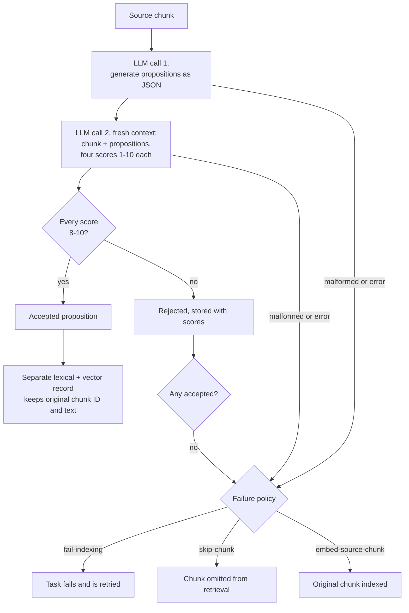
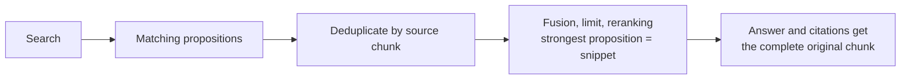

# Retrieval

ContextCrate supports two crate-scoped chunk retrieval strategies. **Standard retrieval** is the default and indexes each source chunk directly. **Proposition retrieval** converts each chunk into independently understandable factual statements and indexes only statements that pass grading. Document-level records are unchanged.

Configure the strategy on the crate **Settings** page or with `PUT /api/v1/crates/{crateId}/settings/rag`:

```json
{
  "strictGrounding": false,
  "allowClientHistory": true,
  "inlineCitations": true,
  "structuredSources": true,
  "retrievalMode": "hybrid",
  "retrievalStrategy": "proposition",
  "propositionFailurePolicy": "fail-indexing",
  "sourceLimit": 8
}
```

Proposition retrieval requires enabled, configured embedding and answer providers. It reuses the crate's OpenAI-compatible answer endpoint, model, credentials, headers, timeout, and output-token limit. Generation and grading are deterministic non-streaming requests with temperature zero.

> **Neighbouring chunks:** the [context window](context-window.md) expands each matched chunk with the chunks before and after it when the answer is prepared.
>
> **Index time or query time?** Proposition retrieval and [contextual chunk
> headers](contextual-headers.md) change what is **indexed** and rebuild the index when switched.
> [HyDE](hyde.md) changes what is **searched with** at question time and needs no rebuild. They can
> be combined, except that propositions are not given a header because they already stand alone.

## Generation and grading

ContextCrate makes two independent LLM calls for each chunk. The first asks for JSON propositions. Every proposition must state one fact, work without additional context, replace pronouns and ambiguous references with full names, preserve dates, data, names, and qualifications, and contain a clear subject, verb, and object.

The second call starts with a new message context and receives the original chunk plus all generated propositions. It assigns four integer scores from 1 through 10:

1. Fidelity to the original statement.
2. Comprehensibility without further context.
3. Completeness of stated data, names, and qualifications.
4. Focus and freedom from unnecessary words.

A proposition is accepted only when **every score is 8–10**. Scores are never averaged. Malformed JSON, mismatched ordinals, missing ratings, out-of-range scores, provider errors, and a result with no accepted propositions invoke the configured failure policy.



At query time the records are folded back together:



## Example

The illustrative chunk below comes from an operations guide:

> *It supports TLS 1.3. Restart it after changing the certificate, otherwise the old one stays in use.*

Embedded as it is, "it" has no meaning and a search for "restart Nginx after certificate change"
may miss it. The generation call returns standalone facts:

1. Nginx supports TLS 1.3.
2. Nginx must be restarted after its certificate is changed.
3. If Nginx is not restarted after a certificate change, the old certificate stays in use.

Each fact is rated by the second call. Facts 1 and 2 may score 9–10 on all four scales and be
accepted. Fact 3 could score 7 on *focus* because it repeats fact 2, and is then rejected. Only
accepted facts are embedded and indexed; the search result still opens the whole original chunk.

## Standard or proposition retrieval?

| | Standard | Proposition |
|---|---|---|
| Indexing cost | One embedding per chunk | Two LLM calls per chunk plus one embedding per accepted proposition |
| Query-time cost | Unchanged | Unchanged, apart from a larger index |
| Good for | Most documentation, code, FAQs | Dense prose with pronouns and implicit references: policies, manuals, reports, wikis |
| Weak for | Chunks that depend on context ("it", "the above") | Source code and tables, which do not break down into facts well |
| Failure mode | Poor recall for context-dependent chunks | Indexing fails or skips chunks if the model is unavailable or answers badly |

Start with standard retrieval. Switch a crate to propositions when you see good content that is
not found, and the missing chunks are the ones that rely on surrounding context.

## Rebuilds and caching

Evaluations are keyed by a fingerprint of the chunk's content hash, the model and endpoint, and the
prompt version. This has practical consequences:

- Re-running an ingestion job over unchanged content **reuses** the stored evaluations and makes no
  LLM calls.
- Changing the answer model or endpoint **invalidates** the cache. The next rebuild pays the full cost again.
- Edited chunks are re-evaluated; untouched chunks in the same document are not.
- Switching from `proposition` back to `standard` needs no LLM calls; the chunk records are indexed directly.
- If a rebuild fails part-way, the previous active index keeps serving searches.

## Troubleshooting

| Symptom | Likely cause | What to do |
|---|---|---|
| Indexing tasks keep failing and retrying | Policy is `fail-indexing` and the model returns invalid JSON, or the endpoint is down | Check the answer model settings and its logs; use a model that follows JSON instructions reliably, or choose `skip-chunk` while investigating |
| Many chunks are missing from search | Policy `skip-chunk` and strict scores reject most propositions | Review rejected propositions on the document details page; try a stronger model, or `embed-source-chunk` |
| Rebuild is slow and costly | Cache invalidated by a model change | Expected once; plan model changes before large re-ingestions |
| Search snippets show a short sentence instead of the paragraph | By design: the strongest proposition is the snippet | Use the chunk text from the result; answers and citations always get the full chunk |

## Failure policies

| Policy | Behavior |
| --- | --- |
| `fail-indexing` | Default. Fail the index task so the pipeline retries it and eventually exposes failed work. |
| `skip-chunk` | Continue indexing but omit the affected chunk from retrieval. |
| `embed-source-chunk` | Index the original chunk, allowing a deliberately mixed proposition/standard generation. |

Generation-based rebuilds keep the previous active index when a new generation fails.

## Storage and search behavior

Evaluations persist with their model, prompt version, source hash, status, diagnostics, proposition text, four scores, and acceptance state. A matching fingerprint is reused during rebuilds; source, model, endpoint, or prompt changes invalidate it. The document details page and chunk propositions API expose accepted and rejected results.

Each accepted proposition becomes a separate lexical and vector record, but retains the original chunk ID and source text. ContextCrate deduplicates records by source chunk before fusion, limiting, reranking, or answer-source selection. The strongest proposition supplies the search snippet and reranking text; answer generation and citations receive the complete original chunk.

## Cost and privacy

Proposition retrieval adds two LLM requests for every uncached chunk plus embedding work for every accepted proposition. Source chunks and generated propositions are sent to the configured answer provider. Prompts and credentials are not written to audit logs, but evaluations and scores are stored in the crate database. Use TLS and treat the provider as a data processor.

## Generated questions as index records

With [document enrichment](document-enrichment.md) the index also holds, for each chunk, the questions a model wrote for it. A hit whose best record is such a question is reported as its parent chunk: the chunk text is the content, the snippet and the reranking input, and each chunk appears once.
