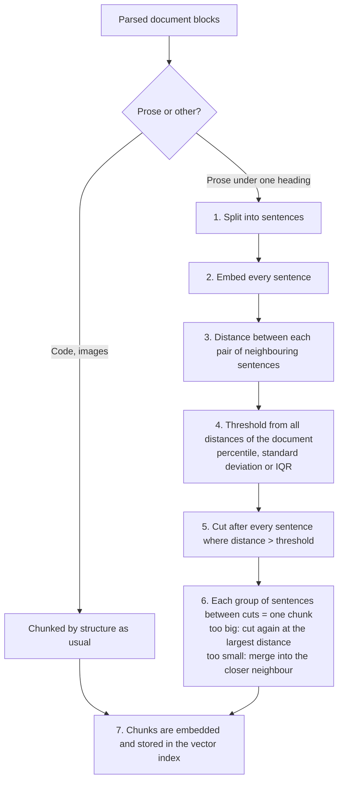

# Semantic chunking

Normal chunking cuts a document by **size**: blocks are packed until a chunk is full. That ignores
where the topic changes, so one chunk can hold the end of one topic and the start of the next, and its
embedding describes neither well. **Semantic chunking** cuts where the *meaning* changes instead.

It is an option of the **ingestion job** (section **Content and chunks**), off by default. Every
other part of the pipeline is unchanged: the finished chunks are embedded and indexed like any other chunk.

## How it works

1. **Sentences.** Each paragraph is split into sentences. A "sentence" longer than the chunk size (a long table row, text without punctuation) is cut like long prose.
2. **Embeddings.** Every sentence is embedded with the crate's embedding model, in batches of 64. These vectors are temporary and are not stored.
3. **Distances.** For every two neighbouring sentences the cosine distance (`1 − similarity`) is computed. A small distance means "same topic", a large one "the topic moved on". Distances are only measured inside a run of prose under one heading, never across a heading.
4. **Threshold.** One threshold per document is derived from all its distances with the selected method.
5. **Cut.** The text is cut after every sentence whose distance to the next one **exceeds** the threshold.
6. **Chunks.** Each group of sentences between two cuts becomes a chunk, under the heading it belongs to.
7. **Embed and store.** As for every chunk, the chunk text (plus a [contextual header](contextual-headers.md) if enabled) is embedded and stored in the index.

## Breakpoint methods

| Method | Threshold | Value | Default | Use it when |
|---|---|---|---|---|
| **Percentile** | the *p*-th percentile of all distances | 50 to 99.9 | 95 | You want a predictable share of cuts: at 95, about 5 % of the sentence boundaries become cuts, whatever the document is like. |
| **Standard deviation** | mean + *k* × standard deviation | 0.5 to 6 | 3 | Documents with clearly separated topics: only boundaries that are unusual compared with the average one are cut. |
| **Interquartile range** | Q3 + *k* × (Q3 − Q1) | 0.5 to 5 | 1.5 | Documents with a few extreme jumps: the IQR is robust against outliers, which would inflate the standard deviation. |

Worked example with ten distances `1 2 3 4 5 6 7 8 9 10` (scaled): the 95th percentile is 9.55, so only
the boundary with distance 10 is cut. Mean + 1 × standard deviation is 5.5 + 2.87 = 8.37, which cuts the
boundaries with 9 and 10. Q3 + 1.5 × IQR is 7.75 + 6.75 = 14.5, which cuts nothing, because no jump is an
outlier. Lower the value to get more, smaller chunks; raise it for fewer, larger ones.

## Size limits

* **Maximum.** A chunk never exceeds the job's **chunk size** (which the embedding model's input limit can lower further). A group that is too large is cut again at the largest distance inside it, repeatedly, until all parts fit.
* **Minimum.** A group below **Minimum chunk size** (default 100 characters, at most half the chunk size) is merged into the neighbour across the smaller distance, as long as the result still fits.
* **Structure.** Headings are always boundaries. Code blocks and images are chunked as before and keep their position between the prose chunks. In this mode, small prose is not packed together with an adjacent code block.

## Existing documents and changing the setting

Nothing changes for documents that were ingested before. When you switch semantic chunking on, off, or
change method, value, minimum size, chunk size, overlap or the crate's embedding model, the **next run
of the job** chunks the affected documents again and stores them as a **new document version**, even if the
content itself did not change. Documents of a job whose chunking settings stay the same are skipped as
"unchanged", as usual.

## Cost and failure behaviour

* Cost: **one embedding per sentence** for each new or changed document, in addition to the chunk embeddings. The crate's embedding model is used.
* A document with more than 5,000 sentences, a document with fewer than four sentence boundaries, or a failure of the embedding model does not fail the ingestion: the document is chunked by size. The metric `contextcrate_ingestion_semantic_fallback_total{reason}` counts it and the document details page tells why. If the cause may be temporary (`unavailable`, `error`), the next run tries again.
* Semantic chunks have no overlap: sentences are never repeated. Chunks that continue a paragraph are joined with a space and chunks that start a paragraph with a blank line, so the [context window](context-window.md) restores the original text exactly.

## Where to see it

* The document details page shows how a document was chunked ("Chunked semantically (percentile 95, threshold 0.31, 42 sentences, 9 breakpoints)").
* Grafana row **Semantic chunking**: sentences and breakpoints per document, average threshold, fallbacks by reason. See [Operations](../operations.md#metrics).

## Tuning

* Chunks too large or unfocused: lower the percentile (for example 90) or the multiplier.
* Chunks too small and fragmented: raise the percentile (for example 98) or the multiplier, or raise the minimum chunk size.
* Many fallbacks with reason `unavailable`: the embedding model of the crate is disabled or unreachable.
