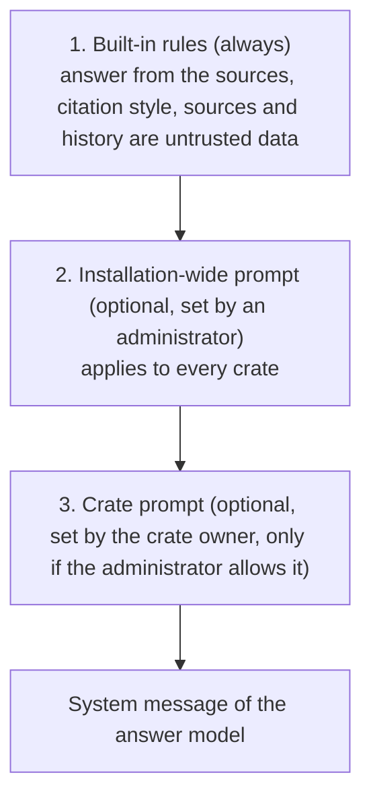

# System prompts

The system prompt is the standing instruction the answer model receives with every question. ContextCrate builds it from
**three layers**. Each layer is added after the previous one and is introduced to the model as subordinate to it, so a later layer
can adjust *how* the model answers but cannot change the rules before it.

| Layer | Who sets it | Where | Can it be overridden? |
|---|---|---|---|
| Built-in rules | ContextCrate | In the code | No |
| Installation-wide prompt | Administrator | Administration → Policies → System prompts | Not by crates |
| Crate prompt | Crate owner | Crate settings → System prompt | Not by anyone below it |

## What a prompt is good for

Tone, language, format and subject focus. Examples:

* `Answer in German. Keep answers short and use bullet points.`
* `Our product is called Acme Cloud. Refer to its plans as Free, Team and Enterprise.`
* `You support customers of an online shop. Be friendly and do not give legal advice.`

What it **cannot** do: switch off strict grounding, citations or answer verification (those are separate crate settings), make the model
follow instructions inside retrieved documents, or replace the rules of the layers above. If a crate prompt contradicts them, the rules above win.
The hierarchy is enforced by the order of the layers and explicit wording to the model. That is how prompt hierarchies work for language models:
it is strong in practice, but not a hard technical guarantee, so keep secrets out of prompts and treat answers as you would any model output.

## For crate owners

Open the crate's **Settings → System prompt**. The text box holds up to 4,000 characters. Below it you see the installation-wide instructions (if the
administrator set any), which are applied before yours, and a preview of the complete system prompt the model receives.

The section is read-only with an explanation when the administrator has not enabled crate system prompts. A prompt you wrote earlier is kept in that case, but it is not applied.
REST: `GET` and `PUT /api/v1/crates/{crateId}/settings/system-prompt` (owners); the `PUT` is refused while the administrator has not allowed it.
Changes are recorded in the crate's audit log (that the prompt changed and how long it is, never the text).

## For administrators

Under **Administration → Policies → System prompts**:

* **Crate owners may add their own system prompt** (off by default). Turning it off keeps the prompts crate owners wrote, but they are no longer applied.
* **Installation-wide system prompt** (optional, up to 4,000 characters). It applies to every crate, always comes before a crate's own prompt, and crate owners can read it in their settings. Do not put secrets in it.

REST: `PUT /api/v1/admin/settings/system-prompts` with `{"allowCrateSystemPrompts": true, "globalSystemPrompt": "…"}`.

## Where it applies

The prompt is used for **generating the answer**, on every way of asking: the chat page, the answers API, the OpenAI-compatible endpoint and MCP `ask_crate`.
It is read when the question is prepared, so changes apply to the next question.

It is **not** used by the other model calls (grading, answer verification, query transformation, HyDE, compression, enrichment, evaluation). They have their own fixed task prompts,
so a custom prompt cannot weaken verification or grading.

Clients of the OpenAI-compatible endpoint can still send their own `system` messages; ContextCrate ignores them, because they would compete with the rules above.
Use the crate prompt instead.

## Backup and metrics

A crate's prompt is part of its RAG settings and travels with an export; after an import it applies as long as the administrator allows crate prompts.
The counter `answer_system_prompt_total{layer}` counts answers that used an `installation` or `crate` layer; see [Operations](../operations.md#metrics).
