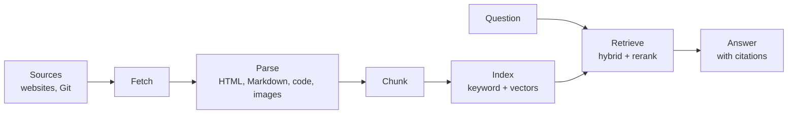

# ContextCrate

ContextCrate is an open-source, self-hosted retrieval-augmented generation (RAG) platform. It
ingests websites and Git repositories, turns them into searchable context, and answers questions
from that context with citations you can trace back to the original source. Your content, your
indexes and your credentials stay on infrastructure you control.

## What you can do with it

- **Collect sources.** Crawl websites (plain HTTP or a headless browser, with robots policy and
  login support) and import Git repositories, including source code and images.
- **Search precisely.** Combine keyword (BM25) and semantic (vector) search, optionally with a
  cross-encoder reranker.
- **Get grounded answers.** Ask questions in the built-in chat, over the REST API, or from any
  OpenAI-compatible client, and get streamed answers with inline source citations.
- **Plug into your tools.** Expose a crate to AI assistants through MCP, or point Open WebUI,
  LiteLLM or an OpenAI SDK at its `chat/completions` endpoint.
- **Keep teams apart.** Every team or use case gets its own **crate** with separate sources,
  members, settings and indexes.
- **Run it your way.** One container on a laptop, or independently scaled roles on Kubernetes.

## Key concepts

| Concept | Meaning |
|---|---|
| **Crate** | The isolation and collaboration boundary. A crate owns sources, documents, settings, members, API keys and its own search index. See [Crates](crates.md). |
| **Source** | A website or Git repository, with its endpoint and credentials. |
| **Ingestion job** | A named configuration for a source: scope, filters, limits, chunk size, schedule. One source can have several jobs. |
| **Run** | One execution of a job. Runs snapshot the configuration, so later edits never change a finished run. |
| **Document** | The cleaned, versioned text of one page or file, produced by [parsing](features/parsing.md). |
| **Chunk** | A passage of a document, the unit that is embedded, searched and cited. See [Chunking](features/chunking.md). |
| **Index generation** | A versioned search index. Changing the embedding model builds a new generation while the old one keeps serving. |
| **Member and key** | People have a role in a crate (Viewer, Editor, Owner). Services use `cc_` API keys. See [Authorization](authorization.md). |

## How it works

Sources are fetched by workers, parsed into clean documents, cut into chunks and indexed. At
question time, ContextCrate retrieves the best chunks, optionally reranks and grades them, and an
answer model writes the response from those chunks only. The full picture is in
[Architecture](architecture.md).

## Deployment modes

| Mode | Runs on | For |
|---|---|---|
| **Standalone** | One process with file-backed H2, a database queue, filesystem artifacts and Lucene | Evaluation, small teams, moderate crawls |
| **Distributed** | Independently scalable roles with PostgreSQL, RabbitMQ, S3-compatible storage and OpenSearch | Production on Kubernetes |

Both modes share the same domain model, so a crate can be exported from one and imported into the
other. See [Installation](installation/README.md).

## How this documentation is organised

The documentation has three sections, each aimed at a different reader.

| Section | For | Start here |
|---|---|---|
| **[Architecture](architecture.md)** | Anyone who wants to understand the concepts and how the parts fit together | [Architecture](architecture.md), then [Crates](crates.md), [Pipeline](pipeline.md), [Authorization](authorization.md) |
| **[Installation and administration](installation/README.md)** | Administrators who install, configure, secure and operate ContextCrate | [Installation](installation/README.md), then [Configuration](configuration.md), [Security](security.md), [Operations](operations.md) |
| **[Usage](usage.md)** | People who create crates, ingest sources, search, chat and integrate | [Using ContextCrate](usage.md), then [Tutorials](tutorials.md) and the [features](usage.md#features) |

Not sure where to begin?

- **"I want to try it."** Follow the [Docker](installation/docker.md) quick start, then the
  [tutorials](tutorials.md).
- **"I need to run it for a team."** Read [Installation](installation/README.md),
  [Deployment](deployment.md) and [Security](security.md).
- **"I want better answers."** See [Parsing](features/parsing.md), [Chunking](features/chunking.md),
  [Retrieval](features/retrieval.md) and [Answers](answers.md).
- **"I want to connect an assistant or app."** See [MCP](integrations/mcp.md), the
  [OpenAI-compatible endpoint](integrations/openai.md) and the [REST API](api.md).
- **"Something is wrong."** See [Troubleshooting](troubleshooting.md).
