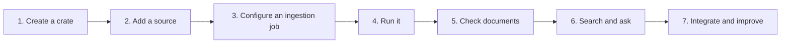

# Using ContextCrate

This section is for people who work with crates: creating them, ingesting sources, searching,
chatting and connecting other tools. If you are installing or configuring ContextCrate itself, see
[Installation and administration](installation/README.md). For the concepts behind the screens,
see [Architecture](architecture.md).

## The workflow

| Step | What you do | Read more |
|---|---|---|
| 1. Create a crate | Sign in and create your first crate. You become its Owner. Invite teammates as Viewer, Editor or Owner. | [Tutorials](tutorials.md#create-the-first-crate), [Crates](crates.md), [Authorization](authorization.md) |
| 2. Add a source | Choose a website or a Git repository and enter its address and credentials. | [Tutorials](tutorials.md#ingest-and-search) |
| 3. Configure a job | Set scope, include and exclude globs, limits, chunk size and a schedule. | [Parsing](features/parsing.md#choosing-which-git-files-are-imported), [Chunking](features/chunking.md), [Configuration](configuration.md#sources-and-ingestion-jobs) |
| 4. Run it | Start the job and follow the pipeline stages. A fetch failure for one source only gives a warning. | [Pipeline](pipeline.md) |
| 5. Check documents | Open a document to see its chunks, versions and images. | [Parsing](features/parsing.md), [Images](features/images.md) |
| 6. Search and ask | Search from the crate overview or chat. Answers cite their sources. | [Retrieval](features/retrieval.md), [Answers](answers.md) |
| 7. Integrate and improve | Connect assistants and apps, then tune quality in the crate settings. | [Integrations](#integrations), [Features](#features) |

## Features

The features are listed in the order content flows through the system.

| Feature | What it does | Page |
|---|---|---|
| **Parsing** | Turns web pages, Markdown and source code into clean documents; keeps code blocks, tables and headings; import control for Git files. | [Parsing](features/parsing.md) |
| **Chunking** | Cuts documents into passages along their structure, with chunk size and overlap. | [Chunking](features/chunking.md) |
| **Contextual headers** | Puts the document title, summary and section path in front of every chunk before it is embedded. | [Contextual headers](features/contextual-headers.md) |
| **Images** | Makes meaningful images searchable and optionally describes them with a vision model. | [Images](features/images.md) |
| **Embeddings** | Local or remote models that create the vectors for semantic search. | [Embeddings](embeddings.md) |
| **Retrieval** | Standard and proposition retrieval, lexical, semantic, hybrid or fusion. | [Retrieval](features/retrieval.md) |
| **Semantic chunking** | Optional per ingestion job: cuts text where the topic changes, based on sentence embeddings, instead of by size. | [Semantic chunking](features/semantic-chunking.md) |
| **Document enrichment** | The model writes questions each chunk answers; they are indexed and lead back to the chunk, so user questions match questions instead of passages. | [Document enrichment](features/document-enrichment.md) |
| **System prompts** | An installation-wide prompt and an optional prompt per crate adjust tone, language and focus of answers; the built-in rules always come first. | [System prompts](features/system-prompts.md) |
| **Contextual compression** | A model keeps only the sentences of each retrieved chunk that matter for the question and drops the rest, to save tokens. | [Contextual compression](features/contextual-compression.md) |
| **Context window** | Adds the chunks before and after each matched chunk to the answer context, without the chunk overlap. | [Context window](features/context-window.md) |
| **Reranking** | Optional batched cross-encoder, or LLM based rating from 1 to 10, that reorders the best candidates. | [Reranking](reranking.md) |
| **Query transformation** | Rewrites vague, specific or multi-part questions before searching. | [Query transformation](features/query-transformation.md) |
| **HyDE** | Searches with an embedded hypothetical answer instead of the question. | [HyDE](features/hyde.md) |
| **Answers** | Grounded answer generation with streaming and citations. | [Answers](answers.md) |
| **Grading** | Drops retrieved chunks the model judges irrelevant. | [Grading](features/grading.md) |
| **Answer verification** | Checks the answer against its sources and revises or blocks unsupported claims. | [Answer verification](features/answer-verification.md) |
| **RAG evaluation** | Scores sampled answers with a judge model: context relevance, faithfulness, answer relevance. Crate owners only. | [RAG evaluation](features/evaluation.md) |

Most of these are switched on or tuned per crate on the crate's **Settings** page, by its Owner.

## Integrations

| Integration | Use it to | Page |
|---|---|---|
| **MCP** | Give AI assistants (Claude, Cursor and others) search and fetch tools for a crate. | [MCP](integrations/mcp.md) |
| **OpenAI-compatible endpoint** | Point Open WebUI, LiteLLM or an OpenAI SDK at a crate. | [OpenAI endpoint](integrations/openai.md) |
| **REST API** | Automate crates, sources, runs, settings, export and import with personal or service keys. | [REST API](api.md) |

## Everyday tasks

- **Add a teammate or service key:** [Tutorials](tutorials.md#add-a-teammate) and [Authorization](authorization.md).
- **Move or back up a crate:** [Export and import](backup-migration.md).
- **Change the embedding model without downtime:** [Embeddings](embeddings.md) and [Crates](crates.md#index-generations).
- **Answers are poor or empty:** [Troubleshooting](troubleshooting.md), then [Retrieval](features/retrieval.md) and [Chunking](features/chunking.md#tuning).
